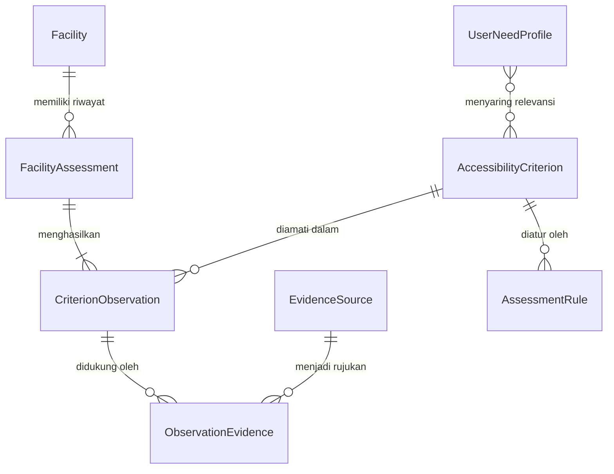

# Dokumentasi Arsitektur & Fondasi Sistem Aksesibilitas Pekanbaru
**Sprint 1 — Fondasi Sistem Aksesibilitas**

---

## 1. Model Data dan Hubungan Antardata

Sistem dirancang dengan pemisahan tanggung jawab yang jelas agar tidak mengunci data pada satu jenis disabilitas saja dan memudahkan transisi dari penyimpanan lokal (LocalStorage) ke Supabase PostgreSQL nantinya.

### Entitas Utama

1. **Facility (`Facility`)**
   - Mewakili entitas fisik fasilitas publik.
   - Properti: `id`, `name`, `type` (`mall` | `public_open_space`), `address`, `coordinates` (`lat`, `lng`), `description`, `operatingHours`, `publicationStatus` (`draft` | `published`), `updatedAt`.
   - *Prinsip:* Tidak memuat klaim aksesibilitas langsung di dalam atribut fasilitas.

2. **AccessibilityCriterion (`AccessibilityCriterion`)**
   - Mewakili kriteria aksesibilitas tertentu.
   - Properti: `id`, `name`, `description`, `needGroups` (array of `NEED_GROUP`), `applicableFacilityTypes` (array of `FACILITY_TYPE`), `evidenceGuidance`, `reference`, `devStatus` (`draft` | `review` | `accepted`).
   - *Prinsip:* Satu kriteria dapat relevan untuk lebih dari satu kelompok kebutuhan pengguna dan lebih dari satu jenis fasilitas.

3. **FacilityAssessment (`FacilityAssessment`)**
   - Pemeriksaan/audit fasilitas pada waktu tertentu.
   - Properti: `id`, `facilityId`, `date`, `method` (`desk_review` | `field_visit` | `user_report`), `assessor`, `notes`, `status` (`in_progress` | `completed`).

4. **CriterionObservation (`CriterionObservation`)**
   - Hasil observasi untuk satu kriteria pada satu asesmen fasilitas.
   - Properti: `id`, `assessmentId`, `criterionId`, `status` (`OBSERVATION_STATUS`), `measuredValue`, `notes`, `observedAt`.

5. **EvidenceSource (`EvidenceSource`)**
   - Sumber pendukung yang melandasi observasi.
   - Properti: `id`, `name`, `type` (`official_website` | `news_article` | `government_document` | `user_report` | `field_observation` | `social_media` | `other`), `url`, `publishedAt`, `accessedAt`, `excerpt`, `limitations`.

6. **ObservationEvidence (`ObservationEvidence`)**
   - Relasi *many-to-many* antara observasi kriteria dan sumber bukti pendukung.
   - Properti: `id`, `observationId`, `evidenceId`.

7. **UserNeedProfile (`UserNeedProfile`)**
   - Profil kebutuhan fungsional pengguna untuk memfilter kriteria relevan.
   - Properti: `id`, `selectedNeeds` (array of `NEED_GROUP`: `mobility`, `vision`, `hearing`, `cognitive`).
   - *Prinsip:* Dimodelkan berdasarkan kebutuhan fungsional, **bukan** diagnosis medis.

8. **AssessmentRule (`AssessmentRule`)**
   - Aturan penilaian yang mendefinisikan kriteria penting/kritis dan penanganan status.
   - Properti: `id`, `criterionId`, `description`, `fulfilledWhen`, `notFulfilledWhen`, `criticalForNeeds`, `unknownHandling`, `version`.

### Diagram Relasi Entitas (ERD)



---

## 2. Definisi Status Observasi

Sistem membedakan secara tegas kondisi fasilitas dan kepastian informasi melalui 5 status:

| Status | Kode | Definisi Operasional |
|---|---|---|
| **Tersedia (Terkonfirmasi)** | `confirmed_yes` | Terdapat bukti terverifikasi dan memadai bahwa kriteria aksesibilitas terpenuhi. |
| **Tidak Tersedia (Terkonfirmasi)** | `confirmed_no` | Terdapat bukti terverifikasi dan memadai bahwa kriteria aksesibilitas tidak terpenuhi. |
| **Belum Diketahui** | `unknown` | Informasi belum tersedia atau belum cukup untuk menarik kesimpulan. **Tidak boleh diubah atau disamakan dengan `confirmed_no`.** |
| **Tidak Berlaku** | `not_applicable` | Kriteria tidak relevan secara kontekstual (misalnya kriteria lift pada bangunan yang hanya 1 lantai). **Tidak dianggap sebagai kegagalan.** |
| **Bukti Bertentangan** | `conflicting_evidence` | Terdapat dua atau lebih sumber bukti dengan klaim saling bertentangan yang belum terselesaikan. Sistem mempertahankan status ini tanpa memilih secara otomatis. |

---

## 3. Logika Penentuan Kriteria Relevan

Penentuan kriteria yang relevan untuk evaluasi suatu fasilitas dilakukan melalui fungsi `getRelevantCriteria(criteria, userProfile, facilityType)`:

1. **Penyaringan Jenis Fasilitas Fisik:**
   Kriteria harus memasukkan jenis fasilitas target ke dalam `applicableFacilityTypes` (misal: kriteria lift hanya relevan untuk `mall`, tidak relevan untuk taman terbuka `public_open_space`).
2. **Penyaringan Kebutuhan Fungsional:**
   Setidaknya salah satu kelompok kebutuhan yang dipilih pengguna (`userProfile.selectedNeeds`) harus beririsan dengan `needGroups` pada kriteria.
3. Satu kriteria yang mendukung kebutuhan ganda (misal: lift aksesibel untuk `mobility` dan `vision`) akan muncul jika pengguna memilih salah satu atau kedua kebutuhan tersebut.

---

## 4. Aturan Ringkasan Penilaian Fasilitas

Fungsi `summarizeAssessment(relevantCriteria, observationMap, rules, userProfile)` merangkum kondisi fasilitas secara transparan:

1. **Pengelompokan Hasil:**
   - `fulfilled`: kriteria dengan status `confirmed_yes`.
   - `notFulfilled`: kriteria dengan status `confirmed_no` (ditampilkan eksplisit, tidak disembunyikan).
   - `unknown`: kriteria tanpa observasi atau berstatus `unknown`.
   - `notApplicable`: kriteria berstatus `not_applicable`.
   - `conflicting`: kriteria dengan bukti bertentangan.
2. **Kriteria Kritis:**
   - Aturan penilaian (`AssessmentRule`) dapat menetapkan kriteria tertentu sebagai kritis untuk kelompok kebutuhan tertentu (misal: ramp pintu masuk kritis untuk mobilitas).
   - Jika terdapat kriteria kritis yang berstatus `unknown`, flag `hasUnknownCritical` bernilai `true`.
3. **Pernyataan Kesesuaian (`canDeclareFullyAccessible`):**
   - Fasilitas **TIDAK PERNAH** diberikan skor angka tunggal arbitrer (misal "skor 85/100").
   - Fasilitas hanya dapat dinyatakan memenuhi kebutuhan spesifik pengguna saat ini (`canDeclareFullyAccessible = true`) jika:
     - `notFulfilled.length === 0` (tidak ada kriteria gagal)
     - `hasUnknownCritical === false` (tidak ada kriteria kritis yang tidak diketahui)
     - `conflicting.length === 0` (tidak ada bukti bertentangan)
     - `fulfilled.length > 0` (setidaknya satu kriteria terkonfirmasi)
   - Sistem **tidak menerbitkan sertifikat kepatuhan** dan tidak mengklaim kepatuhan hukum total.

---

## 5. Komponen yang Sudah Diimplementasikan

- [x] Konstanta domain (`src/domain/constants.js`): enumerasi status, tipe fasilitas, kelompok kebutuhan, jenis bukti.
- [x] Model dan factory functions dengan validasi defensif (`src/domain/models.js`).
- [x] Mesin penilaian berbasis pure functions (`src/domain/assessmentEngine.js`).
- [x] Lapisan abstraksi penyimpanan data lokal (`src/services/dataStore.js`) dengan memory fallback.
- [x] Data awal 10 fasilitas kandidat Pekanbaru dengan status publikasi jujur (`src/data/initialFacilities.js`).
- [x] Kriteria aksesibilitas awal bertanda draft (`src/data/initialCriteria.js`).
- [x] Aturan asesmen awal (`src/data/initialRules.js`).
- [x] Loader data awal (`src/data/index.js`).
- [x] State management React Context (`src/contexts/AccessibilityProvider.jsx` & `accessibilityContextDef.js`).
- [x] Integrasi halaman antarmuka daftar fasilitas (`src/pages/FasilitasPage.jsx`) dengan filter kebutuhan pengguna.
- [x] Pengujian unit komprehensif 19 test case menggunakan Vitest (`src/tests/`).

---

## 6. Bagian yang Memerlukan Keputusan & Validasi Lanjutan

1. **Validasi Kriteria oleh Pakar:**
   Kriteria yang disusun saat ini berstatus `draft` dan dirumuskan oleh pengembang. Diperlukan validasi bersama perwakilan organisasi disabilitas dan ahli aksesibilitas gedung di Pekanbaru.
2. **Skema Pembobotan / Severity Level:**
   Apakah ketidakhadiran toilet aksesibel memiliki tingkat keparahan yang sama dengan ketiadaan guiding block? Saat ini sistem membedakan kriteria biasa vs kriteria kritis, namun belum menetapkan bobot matematis karena butuh landasan akademis/regulasi.
3. **Mekanisme Penyelesaian Bukti Bertentangan (`conflicting_evidence`):**
   Perlu SOP verifikasi jika laporan warga bertentangan dengan materi promosi atau survei sebelumnya.
4. **Validasi Lokasi Fasilitas Tertentu:**
   Status lokasi "Hutan Kota Pekanbaru" dan "Taman Kota Pekanbaru" masih berstatus `draft` karena inkonsistensi koordinat di peta publik digital.

---

## 7. Sumber Data yang Digunakan

Data kandidat fasilitas pada Sprint 1 diambil dari direktori umum publik (Google Maps dan direktori ruang terbuka hijau Kota Pekanbaru) untuk identitas dasar (nama, tipe, koordinat perkiraan).
**Tidak ada data observasi aksesibilitas yang dikarang.** Seluruh fasilitas awal memiliki observasi kosong dan ditandai secara jujur pada antarmuka.

---

## 8. Panduan Menjalankan Pengujian dan Pemeriksaan

1. **Menjalankan Unit Test (Vitest):**
   ```bash
   npm run test
   ```
2. **Menjalankan Linting (Oxlint):**
   ```bash
   npm run lint
   ```
3. **Menjalankan Production Build (Vite):**
   ```bash
   npm run build
   ```
4. **Menjalankan Server Pengembangan Lokal:**
   ```bash
   npm run dev
   ```
