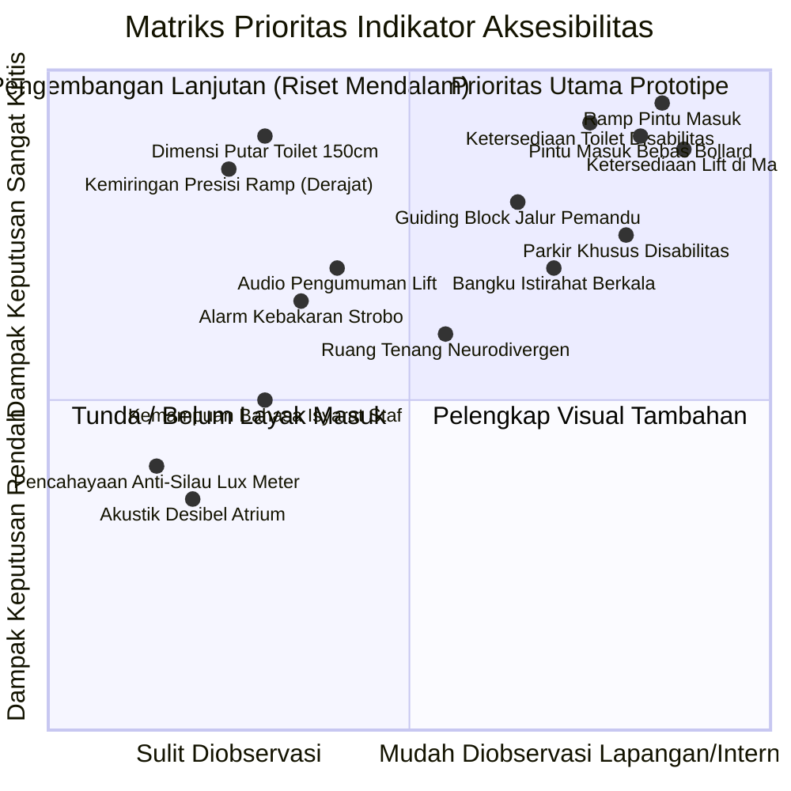

# AUDIT DAN PENGEMBANGAN TAKSONOMI KEBUTUHAN AKSESIBILITAS
**Proyek: Sistem Informasi Aksesibilitas Fasilitas Publik Pekanbaru**  
**Dokumen Teknis & Riset Arsitektural — Sprint 4**

---

## 1. Ringkasan Eksekutif Hasil Audit

Sprint 4 difokuskan pada peran arsitektural dan riset: mengaudit taksonomi kebutuhan fungsional dan 10 kriteria awal yang dibuat pada Sprint 1–3, serta meletakkan landasan konseptual yang kokoh, kredibel, dan berorientasi pada pengguna sebelum penambahan fitur berikutnya.

### Temuan Utama Audit:
1. **Taksonomi 4 Kelompok Awal (`MOBILITY`, `VISION`, `HEARING`, `COGNITIVE`) Terlalu Sederhana**:
   - Belum mengakomodasi dimensi disabilitas mental/psikososial dan neurodivergensi (misal: *sensory processing sensitivity*, autisme, ADHD) yang sangat rentan terhadap beban sensorik (*sensory overload* / kebisingan / pencahayaan silau) di mal dan ruang publik.
   - Mengabaikan kebutuhan stamina/daya tahan fisik (*energy limitations*, penyakit kronis, lansia, wanita hamil) yang tidak selalu menggunakan kursi roda tetapi memerlukan tempat istirahat/tempat duduk berkala (*rest stops/benches*), peneduh, dan jarak tempuh terukur.
   - Mengabaikan disabilitas wicara dan hambatan komunikasi verbal dua arah pada meja layanan/informasi publik.
2. **Kondisi 10 Kriteria Awal**:
   - Seluruh 10 kriteria masih berstatus `DRAFT`.
   - Terjadi penggabungan (*coupling*) berlebihan pada beberapa kriteria: misalnya kriteria lift (`crit_mall_elevator`) mencampuradukkan aspek mekanik mobilitas (dimensi/pintu) dengan aksesibilitas sensorik (audio dan braille); kriteria toilet belum merinci dimensi putar kursi roda (150 cm) vs pegangan rambat (*grab bars*); dan penanda (`crit_signage_clarity`) mencampuradukkan kontras visual dengan kesederhanaan bahasa/piktogram.
3. **Arsitektur Data Saat Ini**:
   - `NEED_GROUP` berbasis `Object.freeze` (konstanta statis) memadai untuk tahap prototipe, tetapi perlu didefinisikan secara lebih mendalam (aspek dan profil fungsional).
   - Relasi *many-to-many* antara kriteria dan kelompok kebutuhan pada `AccessibilityCriterion.needGroups` sudah tepat secara konseptual, namun belum memiliki penjelasan alasan spesifik keterkaitannya (*why it matters for that group*).
4. **Prioritas Prototipe yang Realistis**:
   - Membagi taksonomi menjadi 3 tingkatan kelayakan: **Prioritas Prototipe** (dapat diamati/diperiksa via foto & penelusuran digital), **Pengembangan Lanjutan** (memerlukan pengukuran fisik presisi atau wawancara), dan **Belum Dapat Dimasukkan** (indikator masih abstrak atau belum ada standar operasional di Indonesia).

---

## 2. Kondisi Implementasi Aktual Proyek

Pemeriksaan kode aktual pada repository `C:\test-pa\aksesibilitas-pekanbaru` (branch `main`):

- **Domain Constants (`src/domain/constants.js`)**:
  - `FACILITY_TYPE`: `mall`, `public_open_space`.
  - `NEED_GROUP`: `mobility`, `vision`, `hearing`, `cognitive`.
  - `OBSERVATION_STATUS`: `confirmed_yes`, `confirmed_no`, `unknown`, `not_applicable`, `conflicting_evidence`.
  - `CRITERION_DEV_STATUS`: `draft`, `review`, `accepted`.
  - `REPORT_STATUS`: `pending_verification`, `verified`, `rejected`.
- **Domain Models (`src/domain/models.js`)**:
  - Factory functions: `createFacility`, `createAccessibilityCriterion`, `createFacilityAssessment`, `createCriterionObservation`, `createEvidenceSource`, `createObservationEvidence`, `createUserNeedProfile`, `createAssessmentRule`, `createBarrierReport`.
- **Data & Rules (`src/data/`)**:
  - 10 fasilitas kandidat di Pekanbaru (5 mal, 5 ruang terbuka publik). Fasilitas Taman Kota dan Hutan Kota berstatus `draft`.
  - 10 kriteria awal, semuanya berstatus `DRAFT`.
  - Aturan asesmen awal memetakan kriteria kritis untuk kelompok kebutuhan tertentu.
- **Data Store & State Management**:
  - `dataStore.js`: repositori CRUD berbasis `localStorage` dengan penanganan fallback memori.
  - `AccessibilityProvider.jsx`: context React yang memadukan data fasilitas, profil kebutuhan terpilih, laporan hambatan, dan memicu `summarizeAssessment`.
- **Pengujian & Kualitas**:
  - 40 test cases pada Vitest seluruhnya lulus (100% pass).
  - Oxlint: 0 warnings, 0 errors.
  - Build Vite: bersih dan stabil.

---

## 3. Tugas A — Audit Evaluatif Taksonomi Kebutuhan 4 Kelompok

### A. Evaluasi Kritis Kelompok yang Ada

| Kelompok Saat Ini | Kebutuhan yang Terwakili | Kebutuhan yang Belum Terwakili / Tumpang Tindih | Masalah Konseptual |
|---|---|---|---|
| **MOBILITY** (Mobilitas Fisik) | Pengguna kursi roda manual/motor, pengguna kruk/alat bantu jalan. | - Pengguna dengan keterbatasan stamina/jantung (mudah lelah, butuh duduk sering).<br>- Orang dengan perawakan pendek (*short stature*) / keterbatasan jangkauan.<br>- Kelemahan genggaman tangan (*fine motor control*, handle pintu, keran air). | Cenderung tereduksi hanya menjadi "kursi roda" dan "ada ramp". Banyak fasilitas memiliki ramp tetapi tidak ada tempat duduk istirahat di lorong panjang. |
| **VISION** (Penglihatan) | Tunanetra total (memerlukan *guiding block*, audio). | - Penglihatan parsial (*low vision*).<br>- Buta warna (kesulitan membedakan rambu berbasis warna tanpa teks/simbol).<br>- Silau ekstrem (*photophobia*) akibat refleksi lantai/atap kaca di mal. | Signage sering diasumsikan cukup dengan ukuran font, tanpa mempertimbangkan kontras luminansi (LRV), penempatan bebas pantulan cahaya, dan ubin pengarah vs ubin peringatan. |
| **HEARING** (Pendengaran) | Tuli total yang mengandalkan informasi visual tertulis. | - Kurang dengar (*hard of hearing*) yang terbantu dengan *hearing loop* / mikrofon staf berkontras suara.<br>- Akustik buruk / dengung ekstrem di atrium mal yang menyulitkan pemahaman suara. | Hanya dimodelkan sebagai "pengumuman visual". Layanan tatap muka, penerangan bibir petugas (untuk membaca bibir), dan alarm visual belum tersentuh. |
| **COGNITIVE** (Kognitif) | Pemahaman arah umum. | - Beban sensorik (*sensory overload*) pada autisme/ADHD.<br>- Kebingungan akibat denah yang labirin/tidak intuitif.<br>- Hambatan literasi teks panjang. | Istilah "kognitif" terlalu luas dan kerap disalahartikan sebagai disabilitas intelektual saja, padahal di ruang publik isu terbesarnya adalah *spatial wayfinding* dan *sensory regulation*. |

### B. Usulan Kelompok Kebutuhan Tambahan Berbasis Kebutuhan Fungsional

Untuk merefleksikan ragam kebutuhan secara adil tanpa menggunakan istilah medis:

1. **`STAMINA_PACING` (Keterbatasan Stamina, Jangkauan, dan Ketahanan Fisik)**:
   - *Definisi*: Kebutuhan pengguna yang mengalami kelelahan kronis, nyeri sendi, masalah pernapasan/kardiovaskular, orang tua/lansia, orang dengan perawakan pendek, atau ibu hamil yang memerlukan sirkulasi bertahap, tempat duduk perhentian (*rest benches*), dan ketinggian fasilitas yang terjangkau.
   - *Hambatan di Ruang Publik*: Jarak koridor tanpa tempat duduk di mal besar, ketiadaan peneduh/kursi di taman terbuka, pintu manual yang terlalu berat dibuka (>20–30 N), tombol/wastafel yang terlalu tinggi.
   - *Referensi*: ISO 21542:2021 Klausul 7 & 12; Permen PUPR No. 14/2017 Bab III bagian bangku istirahat.
2. **`SENSORY_ENVIRONMENT` (Sensitivitas Lingkungan Sensorik & Neurodivergensi)**:
   - *Definisi*: Kebutuhan terkait regulasi input sensorik (auditori, visual, kerumunan) bagi individu neurodivergen (Autisme, ADHD, gangguan sensorik) dan mereka yang rentan mengalami *sensory overload*.
   - *Hambatan di Ruang Publik*: Suara musik atrium mal yang memekakkan telinga tanpa area tenang, lampu sorot/flicker neon, ketiadaan area tenang (*quiet room / calm space*) di fasilitas komersial/taman kota.
   - *Referensi*: PAS 6463:2022 (*Design for the Mind – Neurodiversity and the Built Environment* - BSI); W3C Cognitive and Learning Disabilities Accessibility Guidelines.
3. **`COMMUNICATION_SPEECH` (Komunikasi & Wicara)**:
   - *Definisi*: Kebutuhan interaksi informasi dua arah tanpa mengandalkan artikulasi suara verbal (penyandang disabilitas wicara, afasia, atau pengguna bahasa isyarat).
   - *Hambatan di Ruang Publik*: Meja informasi publik yang hanya melayani tanya-jawab verbal, ketiadaan papan interaktif/QR code/teks interaktif.
   - *Referensi*: UU No. 8 Tahun 2016 Pasal 4 & Pasal 97 (Akomodasi yang Layak dalam Pelayanan Publik).

---

## 4. Tugas B — Riset dan Landasan Rujukan Normatif

Riset taksonomi ini menyandarkan pada hierarki regulasi dan standar formal:

### 1. Regulasi Nasional Indonesia (Hukum Positif)
* **Undang-Undang Republik Indonesia Nomor 8 Tahun 2016 tentang Penyandang Disabilitas**:
  - *Status*: Hukum primer tertinggi nasional.
  - *Pasal Terkait*:
    - Pasal 1 ayat (1): Definisi penyandang disabilitas berbasis interaksi sosial dan hambatan lingkungan (*social-functional model*).
    - Pasal 4 ayat (1): Klasifikasi 5 ragam disabilitas (Fisik, Intelektual, Mental, Sensorik, Ganda/Multi).
    - Pasal 97, 98, 99: Kewajiban penyediaan infrastruktur bangunan gedung, jalan, dan ruang terbuka yang aksesibel.
* **Peraturan Menteri Pekerjaan Umum dan Perumahan Rakyat (Permen PUPR) No. 14/PRT/M/2017 tentang Persyaratan Kemudahan Bangunan Gedung**:
  - *Status*: Regulasi teknis operasional resmi di Indonesia.
  - *Ketentuan Teknis Spesifik*:
    - **Pintu**: Lebar bukaan efektif pintu utama minimal 90 cm (pintu ruang minimal 80 cm), handle tipe tuas/horizontal tinggi 90–110 cm dari lantai (Lampiran Bab II).
    - **Ramp**: Kemiringan maksimal dalam gedung 7° (1:8), kemiringan luar gedung maksimal 6° (1:10 atau 1:12 ideal). Lebar bebas minimal 120 cm. Dilengkapi *handrail* ganda (ketinggian 65–80 cm dan 90–100 cm) serta tepi pengaman (*curb/low curb*) 5–10 cm (Lampiran Bab II).
    - **Toilet Aksesibel**: Minimal 1 unit di area publik; dimensi minimal ruang kabin yang memungkinkan putaran kursi roda 180° (diameter lingkaran putar minimal 150 cm); pintu geser atau membuka keluar; ketinggian dudukan kloset 45–50 cm; dilengkapi pegangan rambat horizontal dan vertikal di sisi kloset (Lampiran Bab III).
    - **Parkir Khusus**: Lokasi paling dekat dengan pintu masuk utama (jarak tempuh pedestrian maksimal 60 m); lebar parkir minimal 3,70 m (termasuk ruang bebas transfer kursi roda minimal 120 cm); penandaan vertikal dan horizontal (Lampiran Bab II).
    - **Guiding Block (Jalur Pemandu Taktil)**: Ubin pengarah (*guiding/directional*, motif garis berjarak) dan ubin peringatan (*warning/stop*, motif titik timbul) untuk perubahan arah, tangga, ramp, dan persimpangan (Lampiran Bab II).
    - **Lift Aksesibel**: Lebar pintu masuk lift minimal 90 cm; dimensi dalam kabin minimal 140 cm x 140 cm; tombol dilengkapi huruf braille dan simbol kontras pada ketinggian 90–120 cm; indikator suara lantai dan arah (*talking elevator*) (Lampiran Bab II).

### 2. Standar Internasional
* **ISO 21542:2021 (*Building Construction — Accessibility and Usability of the Built Environment*)**:
  - *Penerbit*: International Organization for Standardization (ISO).
  - *Ketentuan Relevan*: Rantai perjalanan tanpa putus (*continuous accessible path of travel*); persyaratan akustik lingkungan publik; pencahayaan yang merata tanpa silau; sistem evakuasi aman (*areas of refuge* / tempat berlindung sementara).
* **BSI PAS 6463:2022 (*Design for the Mind — Neurodiversity and the Built Environment*)**:
  - *Penerbit*: British Standards Institution (BSI).
  - *Ketentuan Relevan*: Manajemen beban sensorik di fasilitas komersial, penyediaan area tenang (*quiet zones*), pemisahan zonasi aktivitas bising dan tenang, penerangan tidak berkelip (*flicker-free*).
* **W3C WAI Guidelines (Web Content & Cognitive Accessibility Roadmap)**:
  - *Penerbit*: World Wide Web Consortium (W3C).
  - *Ketentuan Relevan*: Prinsip kejelasan informasi visual, ikonografi standar, instruksi langkah demi langkah yang ringkas.

---

## 5. Tugas C — Audit Mendalam 10 Kriteria Awal

Evaluasi satu demi satu terhadap 10 kriteria eksisting:

### 1. `crit_mall_entrance_ramp` (Ramp pada pintu masuk utama)
- **Relevansi**: Sangat Tinggi (kebutuhan dasar mobilitas masuk gedung).
- **Masalah Saat Ini**: Definisi terlalu umum. Hanya menyebut "tersedia ramp". Kenyataannya di lapangan, banyak ramp dibuat dengan kecuraman ekstrem (>15°) atau licin saat hujan sehingga membahayakan pengguna kursi roda.
- **Rekomendasi**: **PERJELAS & SESUAIKAN**.
- **Indikator Operasional**: Adanya jalur landai tanpa undakan tangga; kemiringan wajar (maksimal ~6°–7° atau 1:10–1:12); permukaan tidak licin; memiliki pegangan rambat (*handrail*) di sisi tepi.

### 2. `crit_mall_elevator` (Lift yang dapat diakses)
- **Relevansi**: Sangat Tinggi untuk gedung bertingkat.
- **Masalah Saat Ini**: **Mencampuradukkan aspek fisik dan sensorik**. Keberadaan lift sering dianggap "aksesibel" padahal tombolnya terlalu tinggi, pintu terlalu sempit (<80 cm), atau tidak memiliki indikator suara bagi tunanetra.
- **Rekomendasi**: **PECAH MENJADI 2 ASPEK/KRITERIA**:
  - Kriteria A: *Aksesibilitas Fisik Lift* (dimensi kabin memuat kursi roda putar, lebar pintu minimal 90 cm, ketinggian tombol terjangkau).
  - Kriteria B: *Aksesibilitas Informasi & Sensorik Lift* (tombol braille/timbul kontras, indikator suara/pengumuman lantai otomatis).

### 3. `crit_mall_accessible_toilet` (Toilet aksesibel di mal)
- **Relevansi**: Sangat Kritis (kebutuhan biologis dasar martabat manusia).
- **Masalah Saat Ini**: Banyak mal mengklaim memiliki "toilet disabilitas", namun pintunya membuka ke dalam sehingga pengguna kursi roda terjebak dan tidak bisa menutup pintu, atau dijadikan gudang alat kebersihan (*janitor*), atau kloset tanpa *grab bars*.
- **Rekomendasi**: **PERJELAS INDIKATORNYA**.
- **Indikator Operasional**: Ruang manuver bebas di dalam toilet (minimal lingkaran putar 150 cm); pintu geser atau membuka ke luar; ketersediaan pegangan rambat tumpu (*grab bar*) di sisi kloset; kloset duduk dengan ketinggian ergonomis (45–50 cm).

### 4. `crit_mall_parking` (Parkir khusus disabilitas)
- **Relevansi**: Tinggi (titik awal perjalanan pengguna kendaraan adaptif).
- **Masalah Saat Ini**: Parkir sering kali berukuran sama dengan mobil biasa sehingga pengguna kursi roda tidak dapat membuka pintu samping untuk keluar masuk kursi roda. Sering kali tidak ada akses ramp langsung dari area parkir menuju trotoar lobi.
- **Rekomendasi**: **PERJELAS**.
- **Indikator Operasional**: Area parkir ditandai rambu simbol disabilitas internasional; berjarak dekat ke pintu masuk utama; memiliki ruang transfer bebas ekstra di samping kendaraan (lebar total minimal 3,5–3,7 m); terhubung langsung ke jalur pedestrian tanpa terputus undakan trotoar.

### 5. `crit_park_pathway` (Jalur pejalan kaki yang rata dan stabil di ruang terbuka)
- **Relevansi**: Sangat Kritis di ruang publik terbuka (taman, RTH, hutan kota).
- **Masalah Saat Ini**: "Rata dan stabil" masih multitafsir. Rumput tebal, bebatuan koral hias, paving bergelombang akibat akar pohon adalah hambatan besar bagi kursi roda dan lansia.
- **Rekomendasi**: **PERTAHANKAN & PERJELAS**.
- **Indikator Operasional**: Material permukaan padat (aspal, beton halus, paving rapat tanpa celah besar); lebar jalur minimal 120–150 cm; tidak terputus undakan atau akar pohon; kemiringan memanjang wajar.

### 6. `crit_park_entrance` (Pintu masuk area ruang publik yang aksesibel)
- **Relevansi**: Sangat Tinggi.
- **Masalah Saat Ini**: Banyak taman publik di Indonesia memasang *portal/turnstile/pagar labirin* atau tonggak besi (*bollard*) yang sangat rapat untuk mencegah sepeda motor masuk, namun secara bersamaan memblokir total kursi roda dan kereta dorong bayi.
- **Rekomendasi**: **PERTAHANKAN & FOKUSKAN**.
- **Indikator Operasional**: Pintu masuk memiliki bukaan bersih minimal 90 cm; tidak menggunakan pintu putar atau undakan tanpa jalur pintas kursi roda; bebas dari *bollard* berjarak sempit (<80 cm).

### 7. `crit_park_toilet` (Toilet aksesibel di area publik terbuka)
- **Relevansi**: Sangat Kritis.
- **Masalah Saat Ini**: Di ruang terbuka terbuka, toilet umum kerap berupa toilet portabel sempit atau toilet jongkok dengan tangga masuk 2–3 anak tangga.
- **Rekomendasi**: **PERTAHANKAN (sinkronkan standar dengan toilet mal)**.
- **Indikator Operasional**: Jalur menuju toilet dapat dilalui kursi roda tanpa tangga; kloset duduk; pintu bukaan lebar; pegangan rambat.

### 8. `crit_mall_tactile_guidance` (Jalur pemandu taktil / guiding block)
- **Relevansi**: Sangat Tinggi bagi penyandang disabilitas penglihatan.
- **Masalah Saat Ini**: Sering dipasang secara serampangan (*guiding block to nowhere*), menabrak tiang/pohon, atau ubin licin membahayakan saat basah.
- **Rekomendasi**: **PERJELAS**.
- **Indikator Operasional**: Tersedia ubin pengarah (garis) dan peringatan (titik); terpasang menerus dari pintu masuk/halte menuju lobi atau meja informasi; bebas dari rintangan fisik (tiang, pot, pedagang, kendaraan).

### 9. `crit_signage_clarity` (Penanda dan petunjuk yang jelas)
- **Relevansi**: Tinggi bagi penglihatan parsial dan kognitif.
- **Masalah Saat Ini**: **Mencampuradukkan aspek visual dan kognitif**. Huruf besar dan kontras warna adalah kebutuhan visual; sedangkan piktogram sederhana, bahasa mudah dipahami, dan layout denah adalah kebutuhan kognitif.
- **Rekomendasi**: **PECAH MENJADI 2 KRITERIA**:
  - Kriteria A: *Keterbacaan dan Kontras Visual Penanda* (kontras warna teks dan latar belakang tinggi, font jelas tanpa dekoratif, ukuran huruf proporsional dengan jarak pandang).
  - Kriteria B: *Kemudahan Piktogram & Peta Navigasi* (menggunakan simbol internasional yang universal, peta visual sederhana di persimpangan utama).

### 10. `crit_mall_visual_announcement` (Pengumuman visual)
- **Relevansi**: Sedang hingga Tinggi bagi tuna rungu.
- **Masalah Saat Ini**: Hanya menyebut pengumuman suara yang dialihkan ke visual. Bagaimana dengan alarm evakuasi darurat kebakaran? Jika terjadi kebakaran di mal dan hanya ada sirine suara, pengunjung tuli tidak mengetahui bahaya.
- **Rekomendasi**: **PERLUAS MENJADI SISTEM INFORMASI & PERINGATAN DARURAT MULTISENSORIK**.
- **Indikator Operasional**: Layar informasi publik menyajikan teks berjalan/pemberitahuan tertulis; sistem alarm darurat dilengkapi lampu strobo berkedip visual (*visual fire alarm*).

---

## 6. Tugas D — Matriks Taksonomi Kebutuhan Aksesibilitas Terintegrasi

Hubungan berjenjang:  
$$\text{Kebutuhan Fungsional} \longrightarrow \text{Aspek Aksesibilitas} \longrightarrow \text{Kriteria} \longrightarrow \text{Indikator Terukur} \longrightarrow \text{Metode Bukti}$$

| ID Aspek | Kelompok Kebutuhan Fungsional | Aspek Aksesibilitas | Deskripsi Hambatan / Kebutuhan | Contoh Situasi di Fasilitas Publik | Jenis Fasilitas | Kriteria Potensial | Indikator Awal yang Dapat Diamati | Metode Pengumpulan Bukti | Referensi Standar | Status Validasi |
|---|---|---|---|---|---|---|---|---|---|---|
| **MOB-ENT** | `MOBILITY` | Akses Masuk Tanpa Undakan | Pengguna kursi roda/tongkat terhalang undakan trap tangga di pintu utama. | Lobi mal memiliki 3 anak tangga tanpa ramp landai di sampingnya. | Mal & Ruang Terbuka | Ramp pintu masuk utama | - Ada ramp atau elevasi rata.<br>- Kemiringan $\le 7^\circ$.<br>- Lebar $\ge 120\text{ cm}$.<br>- Ada *handrail*. | Foto lapangan, desk review denah, observasi visual. | Permen PUPR 14/2017 Bab II; ISO 21542 Klausul 8. | Terverifikasi Regulasi |
| **MOB-VER** | `MOBILITY` | Akses Vertikal Gedung Bertingkat | Tidak dapat berpindah lantai jika hanya tersedia eskalator atau tangga biasa. | Pengguna kursi roda di mal bertingkat 4 ingin menuju bioskop di lantai atas. | Mal | Lift fisik aksesibel | - Lebar bukaan pintu lift $\ge 90\text{ cm}$.<br>- Dimensi kabin $\ge 140 \times 140\text{ cm}$.<br>- Ketinggian tombol $\le 120\text{ cm}$. | Foto kabin/pintu, data pengelola, observasi. | Permen PUPR 14/2017 Bab II; ISO 21542 Klausul 15. | Terverifikasi Regulasi |
| **MOB-SAN** | `MOBILITY` | Sanitasi & Toilet Kursi Roda | Toilet umum terlalu sempit untuk kursi roda atau tidak ada pegangan tumpu. | Pengguna kursi roda harus berpindah ke kloset tanpa pegangan, pintu membentur kursi roda. | Mal & Ruang Terbuka | Toilet aksesibel terstandar | - Ruang putar kursi roda diameter $\ge 150\text{ cm}$.<br>- Pintu geser / buka keluar lebar $\ge 90\text{ cm}$.<br>- Kloset duduk dengan *grab bars* kuat di samping. | Foto interior toilet, observasi lapangan, laporan pengguna. | Permen PUPR 14/2017 Bab III; WHO Accessibility Audit. | Terverifikasi Regulasi |
| **MOB-PRK** | `MOBILITY` | Parkir Aksesibel & Transfer | Mobil parkir berdempetan sehingga kursi roda tidak bisa ditaruh di samping pintu mobil. | Area parkir mal penuh, tidak ada ruang transfer 1,2 m di samping mobil. | Mal | Lot parkir disabilitas terhubung | - Lebar lot $\ge 3,7\text{ m}$.<br>- Marka logo disabilitas internasional.<br>- Jalur rata bebas undakan ke pintu masuk. | Foto area parkir, citra satelit, laporan lapangan. | Permen PUPR 14/2017 Bab II; UU 8/2016. | Terverifikasi Regulasi |
| **MOB-PTH** | `MOBILITY` | Jalur Sirkulasi Pedestrian Terbuka | Jalur sirkulasi berbatu, berpasir lepas, atau licin dan berlubang. | Trotoar taman kota berupa paving rusak terangkat akar pohon. | Ruang Terbuka & Mal | Jalur pejalan kaki stabil dan rata | - Permukaan keras dan padat.<br>- Bebas lubang dan undakan mendadak.<br>- Lebar jalur $\ge 120\text{ cm}$. | Foto jalur sirkulasi, video berjalan, observasi. | Permen PUPR 14/2017 Bab II; ISO 21542 Klausul 7. | Terverifikasi Regulasi |
| **MOB-CLR** | `MOBILITY` | Pembatas Pintu / Anti Sepeda Motor | Penghalang anti motor (*bollard*) dipasang terlalu rapat memblokir kursi roda. | Pintu masuk RTH Kaca Mayang dipasangi tiang besi berjarak 50 cm. | Ruang Terbuka | Bukaan masuk bebas rintangan | - Jarak bersih antar tiang $\ge 90\text{ cm}$.<br>- Tidak ada pintu putar mekanik (*turnstile*). | Foto gerbang masuk, laporan masyarakat. | Permen PUPR 14/2017; Panduan Teknis Jalur Pejalan Kaki. | Terverifikasi Rekomendasi |
| **STA-RST** | `STAMINA_PACING` | Tempat Duduk Istirahat Berkala | Lansia dan orang dengan gangguan jantung/keletihan kronis lemas berjalan jauh. | Koridor mal sepanjang 200 meter tanpa satu pun kursi duduk umum. | Mal & Ruang Terbuka | Fasilitas bangku istirahat (*rest stops*) | - Tersedia bangku istirahat di sepanjang sirkulasi utama.<br>- Jarak antar bangku wajar (~50–100 m).<br>- Bangku memiliki sandaran punggung dan tangan. | Observasi visual, foto koridor/taman. | Permen PUPR 14/2017 Bab III; ISO 21542 Klausul 26. | Adaptasi Standar |
| **STA-SHD** | `STAMINA_PACING` | Peneduh dari Panas Ekstrem | Pengunjung dengan kondisi fisik rentan mengalami *heat stroke* di Pekanbaru. | Taman terbuka tanpa pohon peneduh atau kanopi pelindung panas terik. | Ruang Terbuka | Jalur dan area istirahat berpeneduh | - Terdapat kanopi atau vegetasi peneduh di atas jalur/tempat duduk.<br>- Suhu permukaan terhindar dari panas terik langsung. | Foto taman, ulasan pengunjung, pengamatan cuaca/lapangan. | Pedoman RTH Ramah Iklim Tropis; Permen PU 05/PRT/M/2008. | Adaptasi Lapangan |
| **VIS-TAC** | `VISION` | Navigasi Taktil Lantai | Penyandang tunanetra tersesat atau menabrak objek tanpa pemandu tongkat. | Masuk lobi mal tanpa ada garis pemandu menuju lift atau tangga. | Mal & Ruang Terbuka | Jalur pemandu taktil terintegrasi | - Guiding block kuning timbul menerus.<br>- Ubin garis untuk jalan, ubin titik untuk berhenti/peringatan.<br>- Jalur bebas rintangan tiang/pot. | Foto lantai, observasi visual, penelusuran lapangan. | Permen PUPR 14/2017 Bab II; ISO 21542 Klausul 24. | Terverifikasi Regulasi |
| **VIS-CON** | `VISION` | Kontras Luminansi & Keterbacaan Signage | Penglihatan parsial (*low vision*) tidak dapat membaca teks papan informasi abu-abu di atas putih. | Papan petunjuk arah toilet di mal berwarna krom mengkilap dengan huruf tipis. | Mal & Ruang Terbuka | Penanda visual kontras tinggi | - Kontras warna teks dan latar belakang tajam ($\ge 70\%$ perbedaan kontras visual/LRV).<br>- Tidak menggunakan font dekoratif tipis.<br>- Pencahayaan signage merata tanpa silau. | Foto papan penunjuk, evaluasi kontras visual. | Permen PUPR 14/2017 Bab IV; W3C WAI Contrast Principles. | Terverifikasi Standar |
| **VIS-AUD** | `VISION` & `HEARING` | Antarmuka Vertikal Multisensorik | Tunanetra tidak tahu lift sudah di lantai berapa; tuna rungu tidak tahu bel lift berbunyi. | Lift bergerak tanpa suara panggilan lantai dan tombol tidak timbul braille. | Mal | Antarmuka lift audio-braille | - Tombol dilengkapi Braille dan timbul kontras.<br>- Lift memiliki pengumuman suara bahasa Indonesia menyebutkan posisi lantai dan arah gerak. | Foto panel tombol, video/rekaman audio lift. | Permen PUPR 14/2017 Bab II; ISO 21542 Klausul 15. | Terverifikasi Regulasi |
| **HEA-ALM** | `HEARING` | Sistem Peringatan Darurat Visual | Tuli tidak dapat mendengar sirine evakuasi kebakaran mal. | Terjadi alarm darurat, sirine hanya berupa klakson suara melengking tanpa lampu strobo. | Mal | Alarm darurat visual (strobo) | - Terdapat lampu strobo darurat berkedip terang di area publik dan toilet umum saat alarm aktif. | Foto perangkat fire alarm dinding/plafon, dokumen spesifikasi gedung. | Permen PUPR 14/2017 Bab IV; NFPA 72 Accessibility Signaling. | Terverifikasi Standar |
| **HEA-TXT** | `HEARING` | Pengumuman Suara ke Teks | Pengunjung tuli tertinggal informasi operasional, panggilan darurat, atau penutupan toko. | Informasi penutupan mal hanya disampaikan via speaker pengeras suara. | Mal | Layar informasi publik visual | - Tersedia monitor display aktif yang menampilkan pengumuman operasional penting secara tertulis. | Foto layar informasi publik, website mal. | W3C WAI Media Accessibility; ISO 21542. | Adaptasi Rekomendasi |
| **SEN-QUT** | `SENSORY_ENV` | Ruang Tenang / Reset Sensorik | Anak autistik atau individu neurodivergen mengalami *sensory overload* akibat riuh bising. | Atrium mal sangat padat, musik keras, lampu gemerlap memicu kepanikan sensorik. | Mal | Area tenang (*Quiet Room / Calm Space*) | - Tersedia ruangan atau sudut khusus yang minim distraksi suara dan cahaya.<br>- Akses bebas bagi pengunjung yang membutuhkan regulasi diri. | Peta fasilitas mal, wawancara customer service, observasi. | BSI PAS 6463:2022 (*Design for the Mind*); WHO Inclusion Toolkit. | Rekomendasi Mutakhir |
| **COG-WAY** | `COGNITIVE` | Navigasi Simbolik & Peta Intuitif | Pengunjung dengan disabilitas intelektual/gangguan memori tersesat di denah mal yang berbelit. | Mal besar tanpa papan direktori visual sederhana di titik persimpangan utama. | Mal & Ruang Terbuka | Peta direktori visual intuitif | - Tersedia piktogram universal sederhana.<br>- Peta direktori "Anda Berada di Sini" yang konsisten di persimpangan utama. | Foto direktori denah, pengamatan navigasi pengunjung. | W3C Cognitive Guidelines; ISO 21542 Klausul 23. | Terverifikasi Standar |
| **COM-ALT** | `COMMUNICATION` | Meja Layanan Ramah Komunikasi Non-Verbal | Petugas informasi hanya mau melayani komunikasi lisan dan tidak sabar terhadap pengunjung non-verbal. | Penyandang disabilitas wicara kesulitan menanyakan letak toilet atau klinik pertolongan pertama. | Mal | Meja layanan dengan opsi non-verbal | - Staf meja informasi menyediakan alat tulis/tablet/katalog petunjuk visual untuk komunikasi tulis. | Konfirmasi meja informasi customer service, SOP layanan publik. | UU No. 8 Tahun 2016 Pasal 97 (Akomodasi Layak). | Adaptasi Kebijakan |

---

## 7. Tugas E — Evaluasi Kritis Arsitektur Data

Berdasarkan audit kebutuhan di atas, berikut evaluasi terhadap arsitektur teknis sistem saat ini:

### 1. `NEED_GROUP` sebagai Objek Enum Beku (`Object.freeze`)
- **Kondisi Saat Ini**: Didefinisikan statis di `src/domain/constants.js`:
  ```javascript
  export const NEED_GROUP = Object.freeze({
    MOBILITY: 'mobility',
    VISION: 'vision',
    HEARING: 'hearing',
    COGNITIVE: 'cognitive',
  })
  ```
- **Evaluasi**:
  - *Kelebihan*: Sangat cepat, tipe aman (*type-safe*), mudah diuji, tidak memerlukan query database atau state tambahan.
  - *Keterbatasan*: Jika ingin menambahkan kelompok baru (misal: `stamina`, `sensory_env`, `communication`), enum harus diubah di kode sumber, dan validator `requireEnum` akan menolak data lama jika ada perbedaan.
- **Rekomendasi**: Untuk tahap prototipe saat ini, **pertahankan pendekatan konstanta terdefinisi** namun perluas daftar enum dengan kelompok yang tervalidasi. Membuat sistem di mana kelompok kebutuhan menjadi entitas dinamis di LocalStorage/Database pada tahap ini adalah *overengineering* yang tidak perlu sebelum taksonominya matang.

### 2. Hubungan Many-to-Many pada `AccessibilityCriterion`
- **Kondisi Saat Ini**:
  ```javascript
  createAccessibilityCriterion({
    id: 'crit_mall_elevator',
    needGroups: [NEED_GROUP.MOBILITY, NEED_GROUP.VISION],
    applicableFacilityTypes: [FACILITY_TYPE.MALL],
    ...
  })
  ```
- **Evaluasi**:
  - Struktur array `needGroups` ini sangat fleksibel dan terbukti bekerja baik dengan fungsi filter `getRelevantCriteria`.
  - *Kekurangan*: Belum mencatat **mengapa** kriteria itu relevan bagi masing-masing kelompok (aspek apa yang dibutuhkan). Misalnya lift: bagi `mobility` yang penting adalah lebar pintu dan dimensi; bagi `vision` yang penting adalah braille dan audio.
- **Rekomendasi Perluasan Masa Depan (Sprint 5/6)**:
  Tambahkan opsional properti `aspectId` atau sub-kriteria spesifik saat kriteria lift dipecah, tanpa mengubah kontrak array `needGroups`.

### 3. Struktur `AssessmentRule` & Kriteria Kritis
- **Kondisi Saat Ini**:
  `criticalForNeeds: [NEED_GROUP.MOBILITY]`
- **Evaluasi**:
  Sistem ini sangat berhasil mencegah kesimpulan palsu (*false accessibility claim*). Fungsi `summarizeAssessment` memeriksa apakah ada kriteria kritis yang `unknown`. Jika ada, `canDeclareFullyAccessible` bernilai `false`.
- **Rekomendasi**:
  Pertahankan logika ini. Pastikan ketika kriteria baru ditambahkan ke prioritas prototipe, penentuan `criticalForNeeds` didasarkan pada keselamatan dan kebutuhan mutlak (misalnya pintu masuk bebas undakan dan toilet disabilitas adalah kritis mutlak bagi mobilitas).

### 4. Komponen Fasilitas (*Facility Components / Zones*)
- **Kondisi Saat Ini**: Kriteria hanya difilter berdasarkan `applicableFacilityTypes: [FACILITY_TYPE.MALL, FACILITY_TYPE.PUBLIC_OPEN_SPACE]`.
- **Evaluasi**:
  Fasilitas fisik mal atau taman memiliki zona yang berbeda: *Parkir/Drop-off*, *Pintu Masuk/Gerbang*, *Sirkulasi Horizontal*, *Sirkulasi Vertikal*, *Toilet/Sanitasi*, dan *Area Rekreasi/Belanja*.
- **Rekomendasi**:
  Tambahkan field metadata `zone` atau `facilityComponent` pada kriteria (misal: `ZONE.ENTRANCE`, `ZONE.SANITATION`, `ZONE.CIRCULATION`, `ZONE.PARKING`). Ini akan membuat tampilan detail fasilitas di masa depan jauh lebih terstruktur dan mudah dipahami pengguna per area.

---

## 8. Tugas F — Penentuan Prioritas Cakupan Prototipe

Prinsip: **Akurasi & Kelayakan Bukti Sebelum Kompleksitas Fitur.**



### 1. Kategori 1: Prioritas Prototipe (Segera / Layak Implementasi)
*Karakteristik: Sangat berdampak pada keputusan apakah seseorang dapat datang atau tidak; memiliki indikator visual yang dapat diverifikasi melalui foto, denah, atau tinjauan lapangan sederhana.*

1. **Ramp Pintu Masuk Utama** (Ketiadaan undakan vs ada ramp di akses utama).
2. **Pintu Masuk / Gerbang Bebas Rintangan Sempit** (Khusus taman: bebas dari tiang penghalang/turnstile motor sempit).
3. **Ketersediaan Lift di Gedung Bertingkat** (Apakah lift ada dan berfungsi untuk pengunjung).
4. **Ketersediaan Toilet Khusus Aksesibel** (Keberadaan toilet bertanda khusus dengan kloset duduk).
5. **Parkir Khusus Disabilitas Berpenanda** (Keberadaan lot parkir khusus dekat pintu masuk).
6. **Kondisi Permukaan Jalur Pedestrian** (Rata, padat, tidak berlubang besar/berbatu terjal).
7. **Ketersediaan Bangku Istirahat di Sepanjang Sirkulasi** (Bagi lansia dan keterbatasan stamina).
8. **Ketersediaan Jalur Pemandu Taktil (Guiding Block)** (Ada tidaknya ubin pemandu di jalur utama).

### 2. Kategori 2: Pengembangan Lanjutan (Tahap Menengah)
*Karakteristik: Relevan dan penting, namun membutuhkan pengukuran fisik langsung, verifikasi operasional internal, atau pengujian khusus.*

1. **Pengukuran Presisi Kemiringan Ramp ($\le 7^\circ$) & Lebar Bersih Pintu ($\ge 90\text{ cm}$)** (Memerlukan alat ukur / *inclinometer* di lapangan).
2. **Dimensi Ruang Putar Kursi Roda di Dalam Toilet ($\ge 150\text{ cm}$) & Posisi Grab Bars**.
3. **Lift Audio-Braille**: Ketersediaan huruf braille pada tombol dan suara pengumuman lantai lift.
4. **Sistem Alarm Evakuasi Visual (Strobo)**: Memerlukan pemeriksaan saat sistem proteksi kebakaran aktif.
5. **Area Tenang (*Quiet Space*)**: Mengidentifikasi sudut atau ruangan ramah neurodivergen di mal.

### 3. Kategori 3: Belum Dapat Dimasukkan ke Prototipe Saat Ini
*Karakteristik: Membutuhkan audit teknis instrumen tinggi, evaluasi subjektif tanpa baku mutu lokal, atau verifikasi kompetensi personal staf yang dinamis.*

1. **Pengukuran Tingkat Kebisingan Akustik Atrium (Desibel)**: Fluktuatif bergantung jam operasional dan acara.
2. **Pengukuran Tingkat Pencahayaan (Lux) & Pantulan Silau Lantai**: Membutuhkan alat lux-meter khusus.
3. **Kualifikasi Bahasa Isyarat Petugas Keamanan/Informasi**: Sangat dinamis bergantung pergantian shift karyawan per hari, sulit diverifikasi sebagai fasilitas fisik statis.

---

## 9. Rekomendasi Restrukturisasi Kriteria Eksisting

Untuk diterapkan secara terencana pada Sprint 5:

1. **Pecah Kriteria Lift**:
   - `crit_mall_elevator_physical`: Lift Fisik (Fasilitas bertingkat memiliki lift yang beroperasi bagi publik).
   - `crit_mall_elevator_sensory`: Lift Ramah Sensorik (Tombol braille timbul dan suara penunjuk lantai).
2. **Pecah Kriteria Penanda**:
   - `crit_signage_visual_contrast`: Penanda Informasi Kontras Tinggi (Keterbacaan visual bagi low-vision).
   - `crit_signage_pictogram_map`: Peta & Piktogram Navigasi (Kemudahan orientasi bagi kognitif).
3. **Perjelas Toilet**:
   - Tambahkan indikator pintu geser/buka keluar dan ketersediaan *grab bar*.
4. **Tambahkan 1 Kriteria Vital Stamina**:
   - `crit_circulation_rest_benches`: Ketersediaan Tempat Duduk Istirahat Berkala di area sirkulasi umum (bagi lansia dan pengguna non-kursi roda).

---

## 10. Referensi Formal dan Sumber Penelitian

1. **Republik Indonesia**. *Undang-Undang Nomor 8 Tahun 2016 tentang Penyandang Disabilitas*. Lembaran Negara RI Tahun 2016 Nomor 69.
2. **Kementerian Pekerjaan Umum dan Perumahan Rakyat RI**. *Peraturan Menteri Pekerjaan Umum dan Perumahan Rakyat Nomor 14/PRT/M/2017 tentang Persyaratan Kemudahan Bangunan Gedung*. Berita Negara RI Tahun 2017 Nomor 1386.
3. **International Organization for Standardization**. *ISO 21542:2021 Building construction — Accessibility and usability of the built environment*. Geneva: ISO, 2021.
4. **World Health Organization (WHO)**. *Access to health services for persons with disabilities: A framework for accessibility audits in health care facilities*. WHO Guidelines & Regional Publications, 2020.
5. **British Standards Institution (BSI)**. *PAS 6463:2022 Design for the mind — Neurodiversity and the built environment — Guide*. London: BSI Standards Limited, 2022.
6. **World Wide Web Consortium (W3C)**. *Cognitive Accessibility Roadmap and Analysis*. W3C Working Group Note, 2021.

---

## 11. Keterbatasan Riset dan Hal yang Memerlukan Validasi Lanjutan

> [!WARNING]
> **Pernyataan Integritas Riset:**
> 1. Dokumen taksonomi ini disusun berdasarkan analisis regulasi formal dan literatur standar aksesibilitas internasional. Dokumen ini **belum merupakan hasil konsultasi langsung** dengan organisasi penyandang disabilitas (seperti HWDI, Pertuni, Gerkatin, atau PPDI Riau/Pekanbaru).
> 2. Penentuan batas kelayakan teknis tidak boleh menggantikan kebutuhan nyata komunitas di Pekanbaru. Pada sprint mendatang, diperlukan sesi dengar pendapat (*stakeholder interview / participatory design*) untuk menguji apakah taksonomi ini menjawab hambatan riil warga Pekanbaru saat berkunjung ke mal dan taman kota.
> 3. Pengumpulan bukti daring (foto ulasan Google Maps / medsos) memiliki batas resolusi visual yang sering kali tidak memperlihatkan kemiringan derajat ramp secara presisi. Oleh karena itu, status `unknown` dan catatan keterbatasan harus tetap dipertahankan jika foto tidak cukup meyakinkan.

---

## 12. Rekomendasi Langkah untuk Sprint 5

Berdasarkan hasil audit menyeluruh ini, langkah teknis yang direkomendasikan untuk Sprint 5 adalah:
1. **Pembaruan Konstanta Domain**: Menambahkan `STAMINA_PACING` ke dalam `NEED_GROUP` dan mendefinisikan label serta deskripsinya.
2. **Refaktor Kriteria Awal Menjadi Kriteria Terperinci**: Menerapkan pemisahan kriteria lift dan penanda informasi visual vs piktogram, serta menambahkan kriteria tempat duduk istirahat berkala.
3. **Penyelarasan Aturan Asesmen (`initialRules.js`)**: Memperbarui aturan terpenuhi/tidak terpenuhi agar bersesuaian dengan kriteria yang telah diperjelas.
4. **Pembaruan UI Filter Kebutuhan**: Memastikan filter kebutuhan fungsional di halaman beranda, daftar fasilitas, dan detail fasilitas menampilkan kelompok kebutuhan baru secara harmonis.
