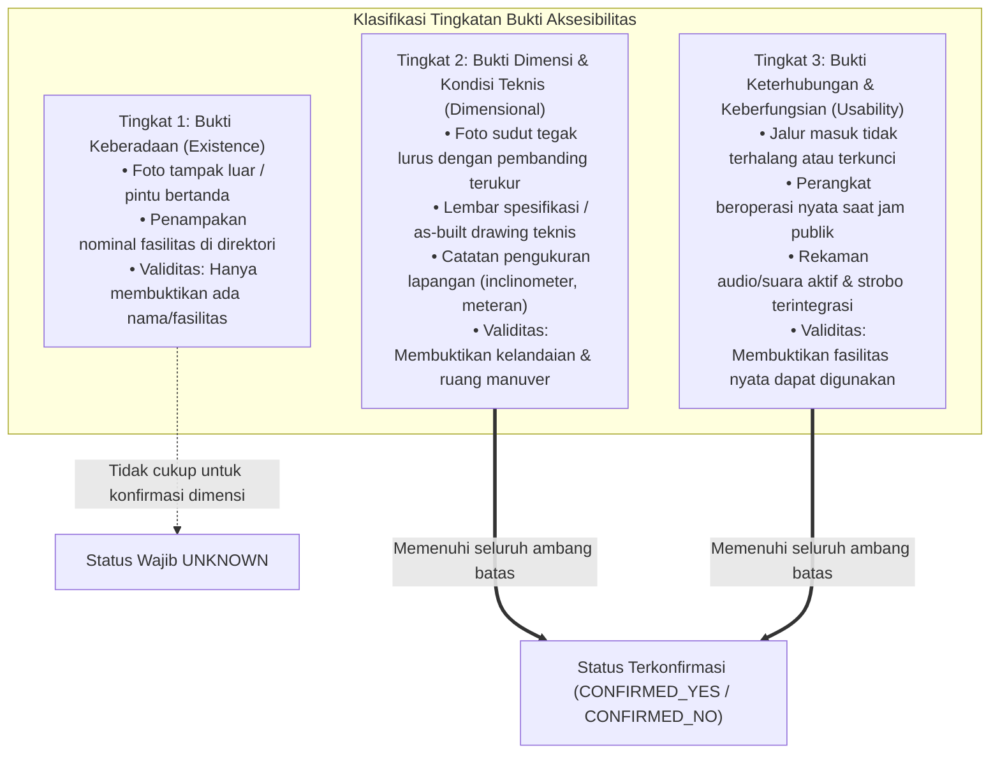

# FINALISASI TAKSONOMI DAN VALIDASI INDIKATOR AKSESIBILITAS
**Proyek: Sistem Informasi Aksesibilitas Fasilitas Publik Pekanbaru**  
**Dokumen Analisis Teknis, Verifikasi Standar, & Perancangan Arsitektur — Sprint 4.1 (Direvisi pada Sprint 4.2)**

---

## 1. Ringkasan Eksekutif & Prinsip Desain

Dokumen ini merupakan hasil revisi terarah (Sprint 4.2) terhadap analisis teknis Sprint 4.1, yang dibangun berdasarkan hasil audit menyeluruh pada Sprint 4 (`docs/sprint-4-audit-taksonomi-aksesibilitas.md`). Fokus utama revisi ini adalah **menyelesaikan inkonsistensi konseptual, menstandarkan penamaan identifier (ID kanonis), membedah indikator multisensorik lift, memisahkan dimensi prioritas secara objektif, merumuskan definisi operasional fasilitas fisik, serta menetapkan batas pembuktian minimum dan aturan ketat status `unknown` sebelum taksonomi diimplementasikan ke dalam kode pada Sprint 5**.

### Prinsip Pokok yang Diterapkan:
1. **Understand the problem before designing the solution**: Membedakan secara tegas antara *Kebutuhan Fungsional Pengguna*, *Aspek Aksesibilitas Lingkungan Fisik*, *Kriteria Penilaian*, *Indikator Pengukuran*, *Metode Pengumpulan*, dan *Tingkat Bukti*.
2. **Functional needs before disability labels**: Menolak kategorisasi berbasis diagnosis medis sempit. Taksonomi disusun berdasarkan cara pengguna berinteraksi dengan lingkungan terbangun (*built environment*).
3. **Evidence before assumptions**: Setiap angka teknis dan rujukan hukum diverifikasi langsung ke teks sumber resmi primer. Angka yang berasal dari interpretasi, sumber sekunder, atau standar berbayar yang belum diverifikasi penuh ditandai secara transparan.
4. **Safety priority regardless of evidence scarcity**: Tingkat kepentingan pengguna dan risiko keselamatan jiwa dipisahkan dari ketersediaan bukti. Fitur keselamatan kritis tidak boleh diturunkan prioritasnya hanya karena data lapangannya sulit diperoleh dari sumber daring.
5. **Rigorous proof levels**: Membedakan bukti keberadaan nominal (*existence*), bukti dimensi teknis (*dimensions*), dan bukti keterhubungan/keberfungsian (*connectivity & usability*). Jika bukti teknis atau keberfungsian belum terpenuhi, sistem wajib menetapkan status evaluasi sebagai `unknown`.
6. **Integritas Tanpa Kompromi**: Tidak ada data sintetis yang disamarkan sebagai data riil, dan tidak ada klaim validasi komunitas/ahli yang dibuat-buat jika belum dilaksanakan secara faktual.

---

## 2. Hasil Audit dan Temuan Inkonsistensi Sprint 4 & 4.1

Evaluasi menyeluruh terhadap dokumen `docs/sprint-4-audit-taksonomi-aksesibilitas.md`, draf awal Sprint 4.1, serta basis kode aktual (`src/domain/constants.js`, `src/domain/models.js`, `src/domain/assessmentEngine.js`, `src/data/initialCriteria.js`) mengidentifikasi sejumlah isu yang wajib diselesaikan:

1. **Inkonsistensi Penamaan ID Kelompok Kebutuhan**:
   - Draf Sprint 4 dan 4.1 mencampurkan beberapa variasi penamaan identifier kelompok kebutuhan, seperti `SENSORY_ENVIRONMENT` vs `SENSORY_ENV`, serta `COMMUNICATION_SPEECH` vs `COMMUNICATION_ACCESS` vs `COMMUNICATION`.
   - Kode aplikasi eksisting (`src/domain/constants.js`) menggunakan pola enum huruf kapital tunggal: `MOBILITY`, `VISION`, `HEARING`, `COGNITIVE`.
   - *Solusi Sprint 4.2*: Menetapkan satu set **ID Kanonis** seragam yang konsisten di seluruh narasi dokumen, tabel matriks, dan skema kode JavaScript masa depan.
2. **Pencampuran Indikator Aksesibilitas Lift**:
   - Draf sebelumnya menggabungkan fitur lift ke dalam satu kriteria fisik dan satu kriteria sensorik gabungan (`CRIT-VIS-ELEV-SENS`) yang menyatukan kebutuhan tuna netra (braille & suara) dan tuna rungu (indikator visual).
   - Hal ini memicu kesalahan fatal di mana kehadiran satu fitur (misalnya tombol braille) dapat disalahartikan bahwa seluruh aspek sensorik lift telah terpenuhi.
   - *Solusi Sprint 4.2*: Membedah indikator lift ke dalam 4 dimensi independen: fisik (`MOBILITY`), braille/taktil (`VISION`), suara/chime (`VISION` & `COGNITIVE`), dan display visual (`HEARING`).
3. **Pencampuran Dimensi Penentuan Prioritas**:
   - Draf awal menurunkan kriteria keselamatan kritis seperti alarm kebakaran visual (`CRIT-HEA-ALARM`) menjadi "Prioritas 2" hanya karena bukti fotonya jarang diunggah pengunjung di Google Maps.
   - *Solusi Sprint 4.2*: Memisahkan secara tegas 4 dimensi: *Tingkat Kepentingan Pengguna*, *Risiko Keselamatan Jiwa*, *Ketersediaan Bukti Terbuka*, dan *Kesiapan Implementasi*. Kriteria keselamatan jiwa tetap berstatus prioritas kritis, namun status observasi awalnya dicatat sebagai `unknown` sampai bukti valid diverifikasi.
4. **Ketidakjelasan Definisi Operasional Bangku Istirahat dan Peneduh Cuaca**:
   - Kriteria bangku istirahat dan peneduh cuaca pada kelompok `STAMINA_PACING` belum memiliki batasan kondisi fisik minimum dan status hukum yang tegas (apakah jarak interval bangku dan suhu merupakan kewajiban hukum atau rekomendasi desain).
   - *Solusi Sprint 4.2*: Merumuskan kondisi fisik minimum (sandaran punggung, sandaran tangan, bebas hambatan) serta memperjelas status regulasinya terhadap Permen PUPR No. 14/PRT/M/2017 dan ISO 21542:2021.
5. **Rancunya Tingkatan Bukti**:
   - Belum ada batas tegas antara foto tampak luar pintu toilet dengan kondisi nyata interior kloset, atau foto sudut miring ramp dengan derajat kemiringan sebenarnya.
   - *Solusi Sprint 4.2*: Menetapkan klasifikasi 3 tingkatan bukti (*existence*, *dimension*, *usability*) dan aturan eksplisit kapan sistem wajib menampilkan status `unknown`.

---

## 3. Keputusan Final yang Telah Disepakati

### 3.1 Standardisasi ID Kanonis Kelompok Kebutuhan Fungsional

Untuk menjamin konsistensi antara konsep, dokumentasi arsitektur, dan kode aplikasi, ditetapkan **7 ID Kanonis** kelompok kebutuhan fungsional pengguna. Seluruh narasi, tabel, dan konstanta domain wajib mengacu pada identifier baku ini:

| ID Kanonis | Nilai String Kode | Nama Kelompok (Bahasa Indonesia) | Definisi Operasional Singkat | Status Kesiapan Sistem |
|---|---|---|---|---|
| `MOBILITY` | `'mobility'` | Mobilitas Fisik & Perpindahan | Kebutuhan sirkulasi dan perpindahan fisik bebas hambatan geometris undakan, celah sempit, atau lantai licin. | **Inti Prototipe (Sprint 1–5)** |
| `STAMINA_PACING` | `'stamina_pacing'` | Daya Tahan Fisik & Istirahat | Kebutuhan jeda pemulihan energi fisik berkala, jarak tempuh bertahap, dan mitigasi paparan cuaca panas ekstrem. | **Inti Prototipe (Implementasi Sprint 5)** |
| `VISION` | `'vision'` | Penglihatan & Navigasi Taktil | Kebutuhan persepsi rute dan informasi bagi pengguna dengan hambatan penglihatan (buta total, low vision, buta warna). | **Inti Prototipe (Sprint 1–5)** |
| `HEARING` | `'hearing'` | Pendengaran & Peringatan Visual | Kebutuhan informasi operasional dan peringatan darurat dalam format visual bagi pengguna tuli atau kurang dengar. | **Inti Prototipe (Sprint 1–5)** |
| `COGNITIVE` | `'cognitive'` | Orientasi Spasial & Pemrosesan Informasi | Kebutuhan pemahaman tata letak fasilitas, simbol grafis universal, dan navigasi mandiri yang tidak membingungkan. | **Inti Prototipe (Sprint 1–5)** |
| `SENSORY_ENV` | `'sensory_env'` | Regulasi Stimulasi Sensorik Lingkungan | Kebutuhan area tenang dan pengendalian input suara/cahaya ekstrem bagi individu neurodivergen atau disabilitas sensorik. | **Tahap Lanjutan (Riset & Desain Siap)** |
| `COMMUNICATION` | `'communication'` | Akses Komunikasi & Layanan Interaktif | Kebutuhan interaksi dua arah non-lisan/adaptif dengan staf layanan publik tanpa paksaan percakapan lisan cepat. | **Tahap Lanjutan (Riset & Desain Siap)** |

> [!NOTE]
> ID kanonis `MOBILITY`, `VISION`, `HEARING`, dan `COGNITIVE` mempertahankan kompatibilitas 100% dengan basis kode eksisting di `src/domain/constants.js`. Penambahan `STAMINA_PACING` pada Sprint 5 serta `SENSORY_ENV` dan `COMMUNICATION` pada tahap lanjutan mengikuti pola enum yang identik tanpa merusak struktur data lama.

---

### 3.2 Pemisahan Mandiri Indikator Aksesibilitas Lift

Aksesibilitas transportasi vertikal (lift) tidak boleh dinilai sebagai satu kesatuan tunggal yang menyederhanakan masalah. Evaluasi lift wajib dipisahkan ke dalam **4 kriteria mandiri** yang masing-masing melayani kebutuhan fungsional berbeda:

1. **Akses Fisik & Dimensi Kabin (`CRIT-MOB-ELEV-PHY`)**:
   - *Kelompok Kebutuhan*: `MOBILITY`.
   - *Kebutuhan Fungsional*: Memastikan pengguna kursi roda, pengguna alat bantu jalan (*walker/crutches*), serta orang tua dengan kereta bayi dapat masuk melewati pintu lift, memiliki ruang manuver di dalam kabin, dan menjangkau panel kontrol.
   - *Indikator Terukur*: Bukaan bersih pintu lift $\ge 90\text{ cm}$; luas kabin bersih $\ge 110\text{ cm}$ (lebar) $\times 140\text{ cm}$ (kedalaman); ketinggian tombol kontrol utama $90–120\text{ cm}$ dari lantai.
2. **Akses Taktil & Huruf Braille (`CRIT-VIS-ELEV-BRAILLE`)**:
   - *Kelompok Kebutuhan*: `VISION`.
   - *Kebutuhan Fungsional*: Memastikan penyandang disabilitas netra dapat secara mandiri mengidentifikasi dan memilih tombol lantai tujuan serta tombol darurat (*alarm/door open*) melalui perabaan jari tangan.
   - *Indikator Terukur*: Tombol pendaratan (*hall call buttons*) dan tombol kabin memiliki angka timbul (*raised tactile characters*, tinggi timbul minimal 1 mm) dan disertai teks huruf Braille standar di samping kiri atau di bawah angka.
3. **Akses Informasi Suara & Umpan Balik Akustik (`CRIT-VIS-ELEV-AUDIO`)**:
   - *Kelompok Kebutuhan*: `VISION` (dan mendukung `COGNITIVE`).
   - *Kebutuhan Fungsional*: Memberikan konfirmasi audibel kepada pengguna yang tidak dapat melihat panel visual mengenai pergerakan lift, arah jalan (naik/turun), kedatangan di lantai tujuan, serta peringatan pintu terbuka/tertutup.
   - *Indikator Terukur*: Terdapat sinyal audio/chime kedatangan yang jelas (nada berbeda untuk naik dan turun) dan sistem suara otomatis (*voice synthesizer announcement*) dwibahasa (Bahasa Indonesia & Inggris) yang menyebutkan posisi lantai secara langsung.
4. **Akses Informasi Visual & Tampilan Status Lift (`CRIT-HEA-ELEV-DISPLAY`)**:
   - *Kelompok Kebutuhan*: `HEARING`.
   - *Kebutuhan Fungsional*: Memastikan pengunjung tuli atau kurang dengar menerima seluruh informasi operasional dan status darurat lift yang biasanya disiarkan melalui bunyi chime atau pengeras suara.
   - *Indikator Terukur*: Layar display digital aktif di luar pintu lift dan di dalam kabin yang menampilkan nomor lantai terkini, arah pergerakan lift (panah visual), indikator status pintu (sedang membuka/menutup), serta indikator visual darurat (*alarm active/help is coming*).

> [!IMPORTANT]
> **Aturan Independensi Penilaian Lift**:
> Keberadaan kabin lift yang luas (`CRIT-MOB-ELEV-PHY = confirmed_yes`) **TIDAK BOLEH** disimpulkan bahwa lift tersebut ramah tuna netra atau tuna rungu. Sebaliknya, lift yang memiliki tombol braille tetapi sempit atau memiliki anak tangga di depan pintunya tetap dinilai tidak aksesibel bagi mobilitas kursi roda. Setiap kriteria dievaluasi secara terpisah.

---

### 3.3 Pemisahan Matriks Prioritas 4 Dimensi Objektif

Untuk mencegah penurunan status fitur keselamatan akibat keterbatasan data daring, sistem memisahkan evaluasi prioritas ke dalam 4 dimensi independen:

1. **Dampak Pengguna (*User Impact*)**: Seberapa signifikan kriteria tersebut dalam menentukan apakah pengguna dapat hadir dan beraktivitas secara mandiri di fasilitas (Kritis / Tinggi / Sedang / Rendah).
2. **Risiko Keselamatan (*Safety Risk*)**: Tingkat bahaya fisik, risiko cedera langsung, atau ancaman keselamatan jiwa dalam kondisi darurat jika kriteria tidak terpenuhi (Kritis-Ekstrem / Tinggi / Sedang / Rendah).
3. **Ketersediaan Bukti Digital (*Evidence Availability*)**: Kemudahan memvalidasi kriteria secara objektif melalui sumber digital terbuka seperti Google Maps, street view, media sosial, atau website resmi pengelola (Tinggi / Sedang / Rendah).
4. **Kesiapan Implementasi (*Implementation Readiness*)**: Kemudahan integrasi teknis ke dalam domain model, aturan penilaian, dan antarmuka prototipe (Siap Sprint 5 / Perlu Riset Lanjutan).

#### Matriks Evaluasi 4 Dimensi

| ID Kriteria | Dampak Pengguna | Risiko Keselamatan | Ketersediaan Bukti Digital | Kesiapan Implementasi | Prioritas Kebijakan Sistem | Status Observasi Awal Jika Bukti Terbatas |
|---|---|---|---|---|---|---|
| `CRIT-MOB-RAMP` | **Kritis** (penentu masuk gedung) | **Tinggi** (risiko terjatuh/terbalik) | Tinggi (foto fasad & lobi banyak tersedia) | Siap Sprint 5 | **Prioritas 1 (Kritis)** | `unknown` jika sudut kemiringan meragukan |
| `CRIT-MOB-GATE` | **Kritis** (penentu masuk tapak taman) | **Sedang** | Tinggi (foto gerbang taman banyak tersedia) | Siap Sprint 5 | **Prioritas 1 (Kritis)** | `unknown` jika celah tiang tidak terukur |
| `CRIT-MOB-ELEV-PHY`| **Kritis** (akses antar lantai bertingkat) | **Tinggi** (terjebak antar lantai) | Tinggi (informasi lift umum mal terbuka) | Siap Sprint 5 | **Prioritas 1 (Kritis)** | `unknown` jika lift publik tidak beroperasi |
| `CRIT-MOB-TOILET` | **Kritis** (kebutuhan fisiologis mutlak) | **Tinggi** (cedera transfer kloset) | Sedang–Rendah (interior jarang dipotret) | Siap Sprint 5 | **Prioritas 1 (Kritis)** | **Wajib `unknown`** jika hanya ada foto pintu luar |
| `CRIT-MOB-PARK` | **Tinggi** (ruang transfer mobil adaptif) | **Sedang** (bahaya lalu lintas kendaraan) | Tinggi (foto pelataran parkir & citra satelit) | Siap Sprint 5 | **Prioritas 1 (Kritis)** | `unknown` jika marka pudar/terhalang |
| `CRIT-MOB-PATH` | **Kritis** (sirkulasi pejalan kaki) | **Tinggi** (roda tersangkut/terjungkal) | Tinggi (foto lanskap taman tersedia luas) | Siap Sprint 5 | **Prioritas 1 (Kritis)** | `unknown` jika kontinuitas rute tidak tampak |
| `CRIT-STA-BENCH` | **Tinggi** (jeda pemulihan stamina) | **Sedang** (kelelahan parah / kolaps) | Tinggi (foto koridor mal & taman umum) | Siap Sprint 5 | **Prioritas 1 (Kritis)** | `unknown` jika hanya ada kursi kafe berbayar |
| `CRIT-STA-SHADE` | **Sedang** (kenyamanan termal Pekanbaru) | **Sedang** (*heat stroke* / dehidrasi) | Tinggi (tutupan tajuk pohon & atap satelit) | Siap Sprint 5 | **Prioritas 1 (Kritis)** | `unknown` jika foto siang hari tidak tersedia |
| `CRIT-VIS-TACTILE`| **Tinggi** (pemandu mandiri tunanetra) | **Tinggi** (terperosok / menabrak objek) | Sedang (butuh verifikasi jalur menerus) | Siap Sprint 5 | **Prioritas 1 (Kritis)** | `unknown` jika hanya terlihat sebagian kecil lantai |
| `CRIT-VIS-CONTRAST`| **Sedang** (keterbacaan informasi teks) | **Rendah** | Tinggi (foto papan direktori/signage) | Siap Sprint 5 | **Prioritas 2 (Standar)** | `unknown` jika foto kabur/silau berlebih |
| `CRIT-VIS-ELEV-BRAILLE`| **Tinggi** (navigasi mandiri lantai lift) | **Sedang** (salah lantai / disorientasi) | Rendah (perlu foto jarak dekat panel tombol) | Siap Sprint 5 | **Prioritas 1 (Kritis)** | **Wajib `unknown`** jika belum ada foto tombol kabin |
| `CRIT-VIS-ELEV-AUDIO`| **Tinggi** (orientasi pergerakan lift) | **Sedang** (disorientasi arah) | Rendah (perlu rekaman audio/video langsung) | Siap Sprint 5 | **Prioritas 1 (Kritis)** | **Wajib `unknown`** jika belum ada rekaman langsung |
| `CRIT-HEA-ELEV-DISPLAY`| **Sedang** (informasi pergerakan lift) | **Rendah** | Sedang (foto interior kabin lift) | Siap Sprint 5 | **Prioritas 2 (Standar)** | `unknown` jika display tidak aktif dalam foto |
| `CRIT-HEA-ALARM` | **Kritis** (keselamatan jiwa saat bencana) | **Sangat Tinggi** (terjebak kebakaran maut) | Rendah (foto strobo dinding jarang dipotret) | Siap Sprint 5 | **Prioritas 1 (Kritis)** | **Wajib `unknown`** sampai terverifikasi fisik |
| `CRIT-HEA-DISPLAY`| **Sedang** (informasi teks operasional) | **Rendah** | Sedang (foto monitor pengumuman mal) | Siap Sprint 5 | **Prioritas 2 (Standar)** | `unknown` jika layar TV hanya berisi iklan |
| `CRIT-COG-WAYFIND`| **Sedang** (kemudahan orientasi ruang) | **Rendah** | Tinggi (foto denah mall / peta taman) | Siap Sprint 5 | **Prioritas 2 (Standar)** | `unknown` jika denah tidak memiliki simbol standar |

> [!IMPORTANT]
> **Prinsip Kebijakan Prioritas Sistem**:
> Kriteria keselamatan jiwa (misal `CRIT-HEA-ALARM` dan `CRIT-MOB-TOILET`) **TETAP MEMILIKI PRIORITAS 1 (KRITIS)**. Keterbatasan bukti daring sama sekali tidak menurunkan status urgensinya di sistem; sistem merespons keterbatasan ini dengan menetapkan status fasilitas tersebut sebagai `unknown`, yang secara jujur memperingatkan pengguna bahwa fasilitas belum terverifikasi keamanannya.

---

### 3.4 Definisi Operasional Bangku Istirahat dan Peneduh Cuaca

#### 1. Bangku Istirahat Berkala (`CRIT-STA-BENCH`)
- **Kondisi Fisik Minimum yang Sah**:
  1. *Stabilitas & Struktur*: Terbuat dari material keras, padat, dan kokoh (batu, semen, besi, atau kayu padat terpasang permanen ke tanah/lantai), tidak goyang atau rapuh.
  2. *Ergonomi Tumpuan*: **Wajib memiliki sandaran punggung (*backrest*)** dan **sangat disarankan memiliki sandaran tangan (*armrests*)**. Sandaran tangan berfungsi vital sebagai tumpuan lengan bagi lansia atau individu dengan nyeri sendi/kelemahan otot untuk bangkit dari posisi duduk.
  3. *Area Sirkulasi Publik Gratis*: Wajib terletak di koridor sirkulasi utama atau ruang terbuka publik yang dapat diakses secara cuma-cuma tanpa kewajiban memesan makanan/minuman (tempat duduk area restoran/food court komersial **TIDAK SAH** sebagai bangku istirahat publik).
  4. *Bebas Hambatan Ruang Sirkulasi*: Bangku diletakkan di luar lebar efektif jalur pejalan kaki (pada ceruk dinding/alcove atau bahu jalan samping) sehingga orang yang duduk atau kaki yang menjulur **tidak memotong lebar bebas jalur pedestrian minimal 150 cm**.
- **Status Regulasi vs Rekomendasi**:
  - *Kewajiban Hukum Positif (Permen PUPR No. 14/PRT/M/2017 Bab III Bagian D)*: Mewajibkan tersedianya perabot jalan (*street furniture*) yang aman, tidak menghalangi sirkulasi pejalan kaki, dan dapat diakses dengan mudah oleh semua orang.
  - *Rekomendasi Standar Internasional (ISO 21542:2021 Klausul 26)*: Jarak interval penempatan tempat duduk istirahat disarankan berada pada **rentang setiap 50–100 meter** di sepanjang koridor sirkulasi yang panjang. **Angka jarak interval 50–100 meter berstatus REKOMENDASI STANDAR INTERNASIONAL, BUKAN MANDAT HUKUM KAKU NASIONAL**. Oleh karena itu, ketiadaan bangku pada jarak presisi 50 meter tidak serta-merta menggugurkan fasilitas jika secara umum bangku istirahat publik tersedia memadai di sepanjang koridor.

#### 2. Peneduh Cuaca Jalur & Tempat Duduk (`CRIT-STA-SHADE`)
- **Kondisi Fisik Minimum yang Sah**:
  1. *Perlindungan Radiasi Surya*: Menyediakan tutupan naungan fisik yang melindungi pejalan kaki dan orang yang duduk dari paparan radiasi matahari terik langsung khas iklim tropis Pekanbaru (suhu rata-rata siang hari mencapai $33^\circ–36^\circ\text{C}$).
  2. *Jenis Naungan*:
     - **Peneduh Alami**: Tajuk pohon rindang (*tree canopy*) dengan susunan dedaunan yang lebat dan bercabang rindang di atas jalur jalan atau bangku taman.
     - **Peneduh Buatan**: Kanopi atap arsitektural (*continuous awning/canopy*), selasar beratap, gazebo publik terbuka, atau pergola dengan kisi-kisi penahan panas yang solid.
  3. *Ketinggian Bebas (*Vertical Clearance*) Peneduh*: Ketinggian ujung bawah atap atau tajuk dahan pohon di atas jalur sirkulasi **minimal 220 cm (2,2 meter)** agar tidak membentur kepala pejalan kaki atau mengganggu tongkat pengguna tunanetra.
- **Status Regulasi vs Rekomendasi**:
  - Parameter tutupan kanopi peneduh dan mitigasi suhu lingkungan merupakan **ADAPTASI KONTEKSTUAL IKLIM MIKRO TROPIS PEKANBARU DAN REKOMENDASI ARSITEKTUR LANSEKAP**, **BUKAN KEWAJIBAN HUKUM STATUTER NASIONAL**. Pada tahap prototipe, evaluasi difokuskan pada ketersediaan naungan fisik di atas area tempat duduk utama dan rute pejalan kaki taman.

---

### 3.5 Klasifikasi Tingkat Bukti & Ketentuan Wajib Status `unknown`

Untuk menjamin keandalan data (*evidence integrity*), sistem menetapkan 3 tingkatan bukti minimum:



#### Ketentuan Wajib Penetapan Status `unknown`:
1. **Toilet Disabilitas**: Jika hanya terdapat foto daun pintu luar bertanda logo disabilitas, namun TIDAK TERSEDIA foto interior yang memperlihatkan kloset duduk, ruang putar kursi roda, dan pegangan tumpu (*grab bar*), maka status kriteria **WAJIB TETAP `unknown`**. Foto pintu luar dilarang keras menghasilkan status `confirmed_yes` (karena sering kali di lapangan toilet tersebut digembok, dijadikan gudang sapu, atau berisi kloset jongkok biasa).
2. **Ramp Akses Masuk**: Jika foto ramp diambil dari sudut miring (*perspective angle*) yang terdistorsi, atau terlihat curam tanpa objek pembanding terukur, dan belum ada pengukuran kemiringan lapangan langsung, status kelandaian **WAJIB TETAP `unknown`** (kecuali jika pintu masuk sama sekali tidak memiliki ramp dan hanya berupa anak tangga curam, di mana status dapat dipastikan `confirmed_no`).
3. **Fitur Sensorik Lift (Braille & Suara)**: Jika informasi hanya berupa foto eksterior sangkar lift atau brosur direktori pengelola gedung, tanpa foto panel tombol jarak dekat (memperlihatkan braille timbul) atau tanpa rekaman audio pergerakan lift, maka status kriteria Braille dan Audio **WAJIB TETAP `unknown`**.
4. **Alarm Evakuasi Darurat Visual**: Jika hanya tampak detektor asap melingkar di plafon atau alarm bel tanpa kubah lampu strobo visual (*flashing beacon*) yang teridentifikasi secara jelas pada foto dinding/plafon koridor atau toilet, maka status **WAJIB TETAP `unknown`**.
5. **Jalur Sirkulasi Pedestrian**: Jika foto ulasan hanya memperlihatkan segmen mulus di dekat gerbang masuk, sementara kondisi rute sirkulasi utama ke area dalam fasilitas belum terdokumentasi, maka status kontinuitas jalur **WAJIB TETAP `unknown`**.

---

## 4. Keputusan yang Masih Terbuka Beserta Alasannya

Meskipun taksonomi dasar dan indikator teknis utama telah dikunci, terdapat 4 keputusan operasional yang secara sadar **dibiarkan terbuka (open decisions)** untuk diselesaikan melalui riset lapangan lanjutan:

1. **Metode Validasi Derajat Kelandaian Ramp Melalui Foto Daring Crowdsourced**:
   - *Kondisi*: Foto pengguna di Google Maps sering kali diambil dengan lensa sudut lebar (*wide-angle smartphone*) yang mendistorsi sudut kemiringan fisik.
   - *Alasan Terbuka*: Sistem belum memiliki modul komputer visi terkalibrasi untuk mengestimasi rasio kemiringan dari gambar 2D. 
   - *Solusi Sementara*: Pada Sprint 5, jika foto visual memperlihatkan ramp landai lengkap dengan handrail ganda dan pertemuan lantai yang mulus, sistem mencatat status `confirmed_yes` dengan tag metadata bukti berkategori `observational_photo_review`, sementara ramp yang meragukan wajib berstatus `unknown`.
2. **Parameter Kuantitatif Ambang Batas Peneduh Cuaca Tropis**:
   - *Kondisi*: Menetapkan persentase tutupan tajuk kanopi pohon (misal minimal 60% rute ternaungi) atau batas perbedaan suhu mikro permukaan lantai di bawah terik matahari Pekanbaru.
   - *Alasan Terbuka*: Standar hukum positif nasional (Permen PUPR 14/2017) tidak mengatur angka persentase tutupan peneduh. Pengukuran suhu mikro membutuhkan sensor termal inframerah (*thermal imaging/surface thermometer*) yang belum realistis pada skala prototipe awal.
   - *Solusi Sementara*: Evaluasi difokuskan secara kualitatif-visual: apakah area duduk istirahat dan rute utama memiliki atap peneduh/tajuk pohon rindang yang melindungi dari sengatan matahari langsung saat siang hari.
3. **Jadwal dan Instrumen Lapangan untuk Kelompok `SENSORY_ENV` dan `COMMUNICATION`**:
   - *Kondisi*: Kriteria ruang tenang (*quiet room*), tingkat kebisingan akustik desibel (dB), dan akomodasi layanan meja informasi non-lisan.
   - *Alasan Terbuka*: Belum ada pusat perbelanjaan atau ruang publik terbuka di Pekanbaru yang mendeklarasikan penyediaan *sensory room* formal. Pengukuran kebisingan dan silau memerlukan sound level meter dan lux meter terkalibrasi, serta interaksi langsung dengan staf pengelola.
   - *Solusi Sementara*: Kedua kelompok kebutuhan ini dimasukkan secara formal ke dalam taksonomi sistem dan enum kode, namun aktivasi evaluasi fasilitasnya ditunda hingga data lapangan tahap awal terisi stabil.
4. **Validasi Empiris Bersama Komunitas Penyandang Disabilitas Lokal Pekanbaru**:
   - *Kondisi*: Konfirmasi bobot kepentingan kriteria bersama organisasi penyandang disabilitas setempat (seperti DPC Pertuni Pekanbaru, DPD Gerkatin Riau, HWDI Riau).
   - *Alasan Terbuka*: Tahap prototipe saat ini berfokus pada fondasi arsitektur perangkat lunak dan kebenaran verifikasi regulasi formal. Uji pengguna (*user study*) lapangan baru akan dijadwalkan setelah prototipe memiliki antarmuka yang berfungsi penuh.

---

## 5. Matriks Komprehensif Indikator dan Bukti Minimum

Tabel berikut merupakan matriks operasional final yang menghubungkan kelompok kebutuhan, aspek, kriteria, indikator teknis terukur, metode pengumpulan, serta bukti minimum yang sah:

| ID Kriteria | Nama Kriteria | Kelompok Kebutuhan | Indikator Spesifik & Terukur | Standar Rujukan Primer | Tingkat Bukti Minimum yang Sah | Kondisi Wajib Status `unknown` |
|---|---|---|---|---|---|---|
| `CRIT-MOB-RAMP` | Ketersediaan Ramp Akses Pintu Masuk | `MOBILITY` | 1. Terdapat jalur ramp permanen di pintu masuk utama gedung/area.<br>2. Tidak ada anak tangga pemutus sirkulasi tanpa alternatif ramp.<br>3. Permukaan lantai kesat dan tidak licin saat basah.<br>4. Kemiringan landai: maksimal $6^\circ$ (rasio 1:10) di dalam gedung, maksimal $5^\circ$ (rasio 1:12) di luar gedung.<br>5. Lebar bersih jalur ramp minimal 120 cm. | Permen PUPR No. 14/PRT/M/2017 Bab II Bagian B.2.c (Wajib Teknis) | **Tingkat 2**: Foto sudut tegak lurus memperlihatkan seluruh bentang ramp dari dasar hingga puncak beserta pertemuan lantai, atau catatan ukur inklinometer. | Sudut kemiringan tampak curam atau tidak terlihat jelas pertemuan lantainya dan belum pernah diukur lapangan. |
| `CRIT-MOB-GATE` | Pintu Masuk Bebas Rintangan Sempit | `MOBILITY` | 1. Bukaan bersih pintu gerbang utama minimal 90 cm.<br>2. Jika terdapat tiang pembatas anti-motor (*bollard*), jarak bebas antar tiang minimal 90 cm.<br>3. Tidak ada pintu putar mekanik (*turnstile*) tanpa jalur bypass samping selebar $\ge 90\text{ cm}$. | Permen PUPR 14/2017 Bab II & Pedoman Teknis Fasilitas Pejalan Kaki (Adaptasi Lapangan) | **Tingkat 2**: Foto pintu gerbang dengan objek pembanding (orang dewasa, motor, atau meteran) yang menunjukkan lebar celah bukaan. | Foto gerbang hanya memperlihatkan pintu gerbang mobil, sementara akses pejalan kaki tidak terpotret. |
| `CRIT-MOB-ELEV-PHY`| Dimensi Fisik & Aksesibilitas Kabin Lift | `MOBILITY` | 1. Lift beroperasi aktif untuk melayani pengunjung publik.<br>2. Bukaan bersih efektif pintu lift minimal 90 cm.<br>3. Luas ruang kabin bersih minimal lebar 110 cm dan kedalaman 140 cm.<br>4. Ketinggian tombol kontrol kabin berada pada rentang 90–120 cm dari permukaan lantai. | Permen PUPR No. 14/PRT/M/2017 Bab II Bagian C.2.a (Wajib Teknis) | **Tingkat 2 & 3**: Foto pintu lift terbuka memperlihatkan interior kabin dan panel tombol, disertai verifikasi bahwa lift aktif digunakan publik. | Tidak ada informasi apakah lift dibuka untuk umum atau lift dalam kondisi mati permanen / khusus staf. |
| `CRIT-MOB-TOILET` | Fasilitas Toilet Disabilitas Aksesibel | `MOBILITY` | 1. Tersedia bilik toilet khusus bertanda aksesibilitas disabilitas.<br>2. Daun pintu membuka ke arah luar atau menggunakan sistem pintu geser (*sliding*).<br>3. Ruang bebas manuver kursi roda di depan kloset minimal $152,5\text{ cm} \times 227,5\text{ cm}$.<br>4. Kloset duduk dilengkapi pegangan rambat kokoh (*grab bar*) setinggi 70–80 cm pada dinding samping dan belakang. | Permen PUPR No. 14/PRT/M/2017 Bab III Bagian A.1 (Wajib Teknis) | **Tingkat 2 & 3**: Foto interior lengkap toilet memperlihatkan kloset duduk, pegangan rambat, arah ayun pintu, dan ruang lantai bebas. | **Wajib `unknown` jika hanya terdapat foto daun pintu luar bertanda logo kursi roda**, tanpa dokumentasi interior bilik. |
| `CRIT-MOB-PARK` | Petak Parkir Khusus Disabilitas | `MOBILITY` | 1. Terdapat petak parkir bertanda marka lambang internasional kursi roda.<br>2. Lebar petak parkir minimal 370 cm (menyediakan ruang transfer bebas kursi roda di samping kendaraan).<br>3. Terletak maksimal 60 meter dari pintu masuk lobi yang dapat diakses, dengan lintasan tanpa undakan trotoar. | Permen PUPR No. 14/PRT/M/2017 Bab III Bagian E.1 (Wajib Teknis) | **Tingkat 2**: Foto area parkir memperlihatkan marka cat lantai logo disabilitas dan jalur sirkulasi menuju pintu lobi mal. | Marka cat di lantai sudah terhapus total atau area parkir dialihfungsikan permanen untuk bongkar muat logistik. |
| `CRIT-MOB-PATH` | Jalur Pedestrian Rata & Bebas Rintangan | `MOBILITY` | 1. Permukaan jalur padat, keras, rata, dan tidak licin saat hujan (aspal halus, semen cetak, paving block rata).<br>2. Lebar efektif bebas rintangan minimal 150 cm (1 arah) atau 160 cm (2 arah).<br>3. Bebas lubang jebakan roda, paving amblas, akar pohon menonjol tinggi, atau tali/tiang melintang. | Permen PUPR No. 14/PRT/M/2017 Bab II Bagian A.1 (Wajib Teknis) | **Tingkat 2 & 3**: Dokumentasi foto atau video penelusuran rute pedestrian utama di beberapa segmen jalan. | Foto hanya memperlihatkan satu titik dekat gerbang tanpa gambaran kontinuitas rute ke dalam taman. |
| `CRIT-STA-BENCH` | Ketersediaan Bangku Istirahat Berkala | `STAMINA_PACING` | 1. Tersedia bangku istirahat umum tanpa keharusan membeli di area sirkulasi.<br>2. Bangku dilengkapi sandaran punggung (*backrest*) yang kokoh.<br>3. Penempatan bangku berada di luar lebar bebas sirkulasi pedestrian ($\ge 150\text{ cm}$).<br>4. Tersedia pada interval berkala di koridor sirkulasi panjang (rekomendasi ~50–100 m). | ISO 21542:2021 Klausul 26 & Permen PUPR 14/2017 Bab III Bagian D (Rekomendasi Standar) | **Tingkat 2**: Foto sirkulasi koridor mal atau jalur taman yang memperlihatkan tempat duduk publik dengan sandaran punggung. | Seluruh tempat duduk yang ada berada di dalam area kafe/restoran berbayar (*commercial dining seats*). |
| `CRIT-STA-SHADE` | Peneduh Cuaca Jalur & Tempat Duduk | `STAMINA_PACING` | 1. Area tempat duduk dan sirkulasi utama memiliki peneduh fisik dari sengatan matahari langsung.<br>2. Peneduh dapat berupa tajuk pohon rindang alami atau struktur atap buatan (kanopi/gazebo).<br>3. Tinggi bebas peneduh minimal 2,2 meter dari permukaan lantai. | Rekomendasi Desain Adaptif Tropis Lembap Pekanbaru (Adaptasi Desain) | **Tingkat 1 & 2**: Foto kondisi pencahayaan siang hari atau citra satelit yang memperlihatkan tutupan naungan vegetasi/atap di atas jalur sirkulasi. | Foto hanya diambil pada malam hari sehingga tutupan peneduh siang hari tidak dapat dianalisis. |
| `CRIT-VIS-TACTILE` | Jalur Pemandu Taktil Lantai (*Guiding Block*) | `VISION` | 1. Tersedia ubin pemandu bertekstur timbul: pola garis (*guiding block*) dan pola titik (*warning block*).<br>2. Memiliki kontras warna tegas (warna kuning cerah standar) terhadap lantai di sekitarnya.<br>3. Jalur terpasang menerus tanpa terputus tiang, pot tanaman, tutup selokan terbuka, atau lapak pedagang. | Permen PUPR No. 14/PRT/M/2017 Bab II Bagian A.2 (Wajib Teknis) | **Tingkat 2 & 3**: Foto rute taktil resolusi tinggi yang memperlihatkan kelanjutan rute dan kebebasan dari rintangan berbahaya. | Pemandu taktil hanya terpasang beberapa ubin dekoratif di lobi lalu terputus total menuju area utama. |
| `CRIT-VIS-CONTRAST`| Keterbacaan & Kontras Visual Signage | `VISION` | 1. Informasi penunjuk arah memiliki kontras luminansi tegas antara teks dan latar belakang (perbedaan LRV $\ge 30\%$).<br>2. Huruf berukuran cukup besar, tegas, tidak menggunakan jenis huruf dekoratif tipis.<br>3. Permukaan papan rambu tidak memantulkan silau lampu sorot langsung. | ISO 21542:2021 Lampiran E & W3C Contrast Guidelines (Standar Internasional) | **Tingkat 2**: Foto signage tegak lurus dengan pencahayaan normal yang memperlihatkan ketajaman teks penunjuk arah. | Foto signage terlalu buram, silau parah (*glare*), atau diambil dari sudut terlalu jauh sehingga huruf tidak terbaca. |
| `CRIT-VIS-ELEV-BRAILLE`| Tombol Angka Timbul dan Huruf Braille Lift | `VISION` | 1. Seluruh tombol pendaratan luar dan tombol kabin lift memiliki relief angka timbul (tinggi timbul $\ge 1\text{ mm}$).<br>2. Terdapat teks huruf Braille standar di samping atau di bawah angka tombol.<br>3. Tombol darurat (*alarm*) dan pembuka pintu memiliki tanda taktil pembeda yang jelas. | Permen PUPR No. 14/PRT/M/2017 Bab II Bagian C.2.a (Wajib Teknis) | **Tingkat 2**: Foto jarak dekat (*close-up*) panel kontrol kabin dan tombol luar lift yang memperlihatkan tekstur braille dan relief angka. | **Wajib `unknown` jika hanya terdapat foto sangkar lift dari kejauhan**, tanpa detail permukaan tombol panel. |
| `CRIT-VIS-ELEV-AUDIO`| Pengumuman Suara Posisi & Arah Lift | `VISION` & `COGNITIVE` | 1. Terdapat sinyal nada/chime audio kedatangan lift (nada pembeda arah naik vs turun).<br>2. Sistem suara otomatis (*talking elevator*) mengumumkan posisi lantai tujuan dan arah pergerakan lift secara jelas dalam Bahasa Indonesia. | Permen PUPR No. 14/PRT/M/2017 Bab II Bagian C.2.a (Wajib Teknis) | **Tingkat 3**: Rekaman video/audio langsung di dalam kabin lift yang memperdengarkan suara otomatis pengumuman lantai saat lift melaju. | **Wajib `unknown` jika data hanya bersumber dari foto statis atau klaim teks direktori brosur**. |
| `CRIT-HEA-ELEV-DISPLAY`| Layar Visual Informasi & Status Lift | `HEARING` | 1. Layar monitor/display digital terpasang aktif di luar pintu dan di dalam kabin lift.<br>2. Menampilkan nomor posisi lantai secara langsung dan tanda panah arah pergerakan lift.<br>3. Menyajikan indikator visual saat pintu membuka/menutup atau saat sistem darurat aktif. | Permen PUPR 14/2017 Bab II & ISO 21542:2021 Klausul 21 (Standar Teknis) | **Tingkat 2 & 3**: Foto atau video panel display lift saat menyala aktif menampilkan nomor lantai dan indikator status pintu. | Display dalam kondisi mati, rusak, atau tidak tampak dalam dokumentasi foto kabin. |
| `CRIT-HEA-ALARM` | Alarm Evakuasi Darurat Visual (Lampu Strobo) | `HEARING` | 1. Terdapat perangkat alarm kebakaran yang dilengkapi lampu strobo visual berkedip terang (*xenon/LED strobe beacon*).<br>2. Lampu strobo terpasang di koridor sirkulasi umum dan di dalam bilik toilet disabilitas.<br>3. Strobo bekerja tersinkronisasi saat sirene bahaya berbunyi. | Permen PUPR No. 14/PRT/M/2017 Bab IV Sistem Keselamatan Bangunan Gedung (Wajib Teknis) | **Tingkat 2 & 3**: Foto fisik perangkat fire alarm dinding/plafon yang secara eksplisit menunjukkan lensa kubah lampu strobo bening berlabel *FIRE*. | **Wajib `unknown` jika hanya tampak smoke detector melingkar di plafon atau tombol fire alarm manual tanpa strobo**. |
| `CRIT-HEA-DISPLAY` | Layar Informasi Operasional Teks Publik | `HEARING` | 1. Tersedia monitor display informasi publik yang aktif di koridor atau lobi utama.<br>2. Pengumuman suara penting (perubahan operasional, evakuasi, imbauan darurat) disajikan secara serentak dalam bentuk teks visual berjalan (*running text / digital signage*). | Panduan Rekomendasi Layanan Informasi Publik Aksesibel (Adaptasi Rekomendasi) | **Tingkat 2 & 3**: Foto atau rekaman video layar monitor informasi fasilitas yang menyiarkan pengumuman operasional tertulis. | Layar TV hanya menyiarkan siaran komersial hiburan swasta atau iklan berbayar tanpa teks operasional fasilitas. |
| `CRIT-COG-WAYFIND` | Peta Lokasi "Anda Di Sini" & Piktogram | `COGNITIVE` | 1. Tersedia papan peta denah fasilitas di lobi pintu masuk atau persimpangan sirkulasi utama.<br>2. Denah memuat penanda posisi saat ini yang intuitif dan tegas (*You Are Here marker*).<br>3. Menggunakan simbol piktogram grafis universal standar ISO 7001 (simbol toilet, lift, pintu darurat, pintu keluar). | ISO 7001 / ISO 21542:2021 Klausul 25 & Permen PUPR 14/2017 (Standar Internasional) | **Tingkat 1 & 2**: Foto papan denah direktori fasilitas resolusi tinggi yang memperlihatkan susunan denah dan piktogram penunjuk arah. | Foto papan denah buram, pecah resolusinya, atau tidak mencantumkan penanda posisi terkini. |

---

## 6. Daftar Sumber Rujukan dan Batasan Validasinya

Dokumen taksonomi dan indikator ini bersandar pada hierarki sumber hukum dan standar teknis yang divalidasi status keterbacaan serta yurisdiksinya:

### 6.1 Regulasi Wajib Hukum Positif Indonesia (Mandatory Statutory Regulations)

1. **Undang-Undang Republik Indonesia Nomor 8 Tahun 2016 tentang Penyandang Disabilitas**:
   - *Status Yuridis*: Hukum Positif Indonesia (Tingkat Undang-Undang).
   - *Klausul Kunci*: Pasal 97–104 mewajibkan penyediaan fasilitas publik yang mudah diakses dan akomodasi yang layak bagi seluruh ragam penyandang disabilitas (fisik, sensorik, intelektual, dan mental).
   - *Akses Dokumen*: Terbuka penuh dan resmi (Lembaran Negara Republik Indonesia Tahun 2016 Nomor 69).
2. **Peraturan Menteri Pekerjaan Umum dan Perumahan Rakyat Republik Indonesia Nomor 14/PRT/M/2017 tentang Persyaratan Kemudahan Bangunan Gedung**:
   - *Status Yuridis*: Peraturan Pelaksana Wajib Teknis (*Technical Mandatory Code*).
   - *Klausul Kunci*:
     - *Lampiran Bab II Bagian A*: Persyaratan teknis jalur pejalan kaki dan jalur pemandu taktil.
     - *Lampiran Bab II Bagian B*: Persyaratan kelandaian ramp tangga (kemiringan maksimal $6^\circ$ atau 1:10 dalam gedung, maksimal $5^\circ$ atau 1:12 luar gedung; lebar bebas min 120 cm).
     - *Lampiran Bab II Bagian C*: Persyaratan lift penumpang aksesibel (lebar pintu min 90 cm, kabin min $110 \times 140\text{ cm}$, tombol kontrol timbul ber-braille ketinggian 90–120 cm, sinyal audio suara dua bahasa).
     - *Lampiran Bab III Bagian A*: Persyaratan ruang toilet disabilitas (ruang manuver bebas $\ge 152,5\text{ cm}$, dimensi total min $152,5 \times 227,5\text{ cm}$, pintu membuka keluar/geser, grab bar kloset).
     - *Lampiran Bab III Bagian E*: Persyaratan fasilitas tempat parkir mobil disabilitas (lebar petak min 370 cm, jarak terjauh ke pintu masuk lobi $\le 60\text{ meter}$).
     - *Lampiran Bab IV*: Persyaratan sistem proteksi keselamatan darurat dan evakuasi (sistem alarm visual berkedip/strobo).
   - *Akses Dokumen*: Terbuka penuh dan resmi (Berita Negara Republik Indonesia Tahun 2017 Nomor 1386).

---

### 6.2 Standar Internasional dan Batasan Aksesnya (International Standards)

1. **ISO 21542:2021 (*Building construction — Accessibility and usability of the built environment*)**:
   - *Status*: Standar Konsensus Internasional (Organisasi Internasional untuk Standardisasi).
   - *Klausul Kunci*: Klausul 21 (antarmuka lift visual dan auditori), Klausul 25 (sistem orientasi dan *wayfinding* grafis), Klausul 26 (penyediaan perabot tempat duduk istirahat publik interval 50–100 m), Lampiran E (metodologi perhitungan kontras luminansi visual / LRV menggunakan rumus Weber dan Michelson, ambang batas $\ge 30\%$ standar dan $\ge 60–70\%$ darurat).
   - *Batasan Akses Dokumen*: **ISO 21542:2021 merupakan standar berbayar berhak cipta (*proprietary copyrighted standard*)**. Verifikasi parameter pada sprint ini dilakukan melalui ringkasan teknis resmi yang dipublikasikan oleh *World Bank / Global Facility for Disaster Reduction and Recovery (GFDRR)* serta kajian literatur peer-reviewed. Rujukan angka teknis wajib dalam aplikasi tetap disandarkan secara yuridis pada Permen PUPR 14/2017.
2. **ISO 7001:2023 (*Graphical symbols — Registered public information symbols*)**:
   - *Status*: Standar Simbol Grafis Piktogram Internasional.
   - *Klausul Kunci*: Simbol aksesibilitas kursi roda (PI PF 006), fasilitas sanitasi aksesibel (PI PF 003), lift penumpang (PI PF 001).
   - *Batasan Akses Dokumen*: Standar berbayar, diverifikasi melalui katalog publik ISO Online Browsing Platform (OBP).
3. **BSI PAS 6463:2022 (*Design for the mind — Neurodiversity and the built environment — Guide*)**:
   - *Status*: Pedoman Standar British Standards Institution (BSI) untuk Desain Neuroinklusif.
   - *Klausul Kunci*: Panduan perancangan ruang tenang (*sensory respite/quiet space*), pengendalian desibel kebisingan latar belakang, serta mitigasi pencahayaan silau (*flicker/glare*).
   - *Batasan Akses Dokumen*: Standar berbayar, dijadikan rujukan konseptual untuk pengembangan masa depan kelompok kebutuhan `SENSORY_ENV`.

---

### 6.3 Pedoman Rekomendasi & Adaptasi Lapangan (Field Adaptations)

1. **Pedoman Perencanaan Jalur Pejalan Kaki di Kawasan Perkotaan (Surat Edaran Menteri PUPR No. 02/SE/M/2018)**:
   - *Penerapan*: Dijadikan dasar adaptasi untuk kriteria pintu masuk bebas rintangan gerbang (`CRIT-MOB-GATE`), khususnya mengenai jarak celah bebas antar tiang pembatas (*bollard*) pejalan kaki minimal 90 cm untuk mengakomodasi lebar kursi roda standar.
2. **Kajian Arsitektur Tropis Lembap Kota Pekanbaru**:
   - *Penerapan*: Karakteristik iklim mikro Pekanbaru dengan radiasi matahari tinggi dan suhu udara siang hari rata-rata $33^\circ–36^\circ\text{C}$ menuntut adanya kriteria peneduh cuaca (`CRIT-STA-SHADE`) pada ruang terbuka publik (RTH Kaca Mayang, RTH Tunjuk Ajar Integritas, Hutan Kota Pekanbaru). Kriteria ini diakui sebagai adaptasi kenyamanan spasial lokal.

---

## 7. Rekomendasi Implementasi Sprint 5 Berdasarkan Hasil Revisi

Dengan dikuncinya taksonomi dan matriks indikator pada dokumen Sprint 4.2 ini, implementasi Sprint 5 dapat langsung dieksekusi ke dalam kode aplikasi tanpa risiko ambiguitas arsitektural. Berikut rincian langkah kerja teknis untuk Sprint 5:

### 7.1 Pembaruan Konstanta Domain (`src/domain/constants.js`)
Perluas objek enum `NEED_GROUP` dengan menambahkan `STAMINA_PACING`, serta siapkan definisi konseptual untuk `SENSORY_ENV` dan `COMMUNICATION`:

```javascript
export const NEED_GROUP = Object.freeze({
  MOBILITY: 'mobility',
  STAMINA_PACING: 'stamina_pacing',
  VISION: 'vision',
  HEARING: 'hearing',
  COGNITIVE: 'cognitive',
  SENSORY_ENV: 'sensory_env',        // Definisi tahap lanjutan
  COMMUNICATION: 'communication',    // Definisi tahap lanjutan
})

export const NEED_GROUP_LABELS = Object.freeze({
  [NEED_GROUP.MOBILITY]: 'Mobilitas Fisik',
  [NEED_GROUP.STAMINA_PACING]: 'Daya Tahan & Istirahat',
  [NEED_GROUP.VISION]: 'Penglihatan & Taktil',
  [NEED_GROUP.HEARING]: 'Pendengaran & Visual',
  [NEED_GROUP.COGNITIVE]: 'Orientasi Spasial & Navigasi',
  [NEED_GROUP.SENSORY_ENV]: 'Lingkungan Sensorik',
  [NEED_GROUP.COMMUNICATION]: 'Akses Komunikasi Layanan',
})

export const NEED_GROUP_DESCRIPTIONS = Object.freeze({
  [NEED_GROUP.MOBILITY]:
    'Kebutuhan sirkulasi fisik bebas tangga/undakan, ramah kursi roda, dan alat bantu jalan.',
  [NEED_GROUP.STAMINA_PACING]:
    'Kebutuhan tempat duduk istirahat berkala dan perlindungan dari panas terik untuk mengatur ritme energi fisik.',
  [NEED_GROUP.VISION]:
    'Kebutuhan pemandu lantai taktil, teks kontras tinggi, informasi huruf Braille, dan petunjuk audio.',
  [NEED_GROUP.HEARING]:
    'Kebutuhan pengumuman teks tertulis, layar informasi visual, dan lampu strobo alarm darurat.',
  [NEED_GROUP.COGNITIVE]:
    'Kebutuhan denah lokasi "Anda Di Sini" dan piktogram visual sederhana yang mudah dipahami.',
  [NEED_GROUP.SENSORY_ENV]:
    'Kebutuhan area tenang dan pengendalian kebisingan/pencahayaan yang ramah neurodivergen.',
  [NEED_GROUP.COMMUNICATION]:
    'Kebutuhan interaksi layanan pelanggan non-lisan/tulis di meja informasi publik.',
})
```

---

### 7.2 Struktur Kriteria Awal & Skema Metadata (`src/data/initialCriteria.js`)
Perbarui dan tambahkan kriteria awal sesuai hasil matriks Sprint 4.2 dengan memanfaatkan properti metadata yang kaya:

1. **Pemisahan Kriteria Lift**:
   - `crit_mall_elevator_physical` (`CRIT-MOB-ELEV-PHY`, `MOBILITY`): fokus dimensi bukaan $\ge 90\text{ cm}$ dan kabin $\ge 110 \times 140\text{ cm}$.
   - `crit_mall_elevator_braille` (`CRIT-VIS-ELEV-BRAILLE`, `VISION`): tombol angka timbul dan huruf braille standar.
   - `crit_mall_elevator_audio` (`CRIT-VIS-ELEV-AUDIO`, `VISION`): suara pengumuman lantai otomatis dan chime pergerakan lift.
   - `crit_mall_elevator_display` (`CRIT-HEA-ELEV-DISPLAY`, `HEARING`): layar display digital penunjuk lantai dan status visual pintu.
2. **Penambahan Kriteria `STAMINA_PACING`**:
   - `crit_circulation_rest_benches` (`CRIT-STA-BENCH`): ketersediaan bangku istirahat publik dengan sandaran punggung di area sirkulasi.
   - `crit_open_space_shade` (`CRIT-STA-SHADE`): peneduh cuaca kanopi/tajuk pohon di area tempat duduk dan sirkulasi taman.
3. **Pemisahan Kriteria Signage & Informasi**:
   - `crit_signage_visual_contrast` (`CRIT-VIS-CONTRAST`, `VISION`): kontras luminansi dan keterbacaan teks penunjuk arah.
   - `crit_signage_pictogram_map` (`CRIT-COG-WAYFIND`, `COGNITIVE`): peta lokasi "Anda Di Sini" dan piktogram simbol universal.
4. **Pembaruan Deskripsi Regulasi Parameter Teknis**:
   - Ramp pintu masuk: kemiringan maksimal $6^\circ$ dalam gedung / $5^\circ$ luar gedung (Permen PUPR 14/2017).
   - Toilet disabilitas: ruang bebas manuver $\ge 152,5\text{ cm}$, pintu geser/buka luar, grab bar kloset (Permen PUPR 14/2017).
   - Parkir disabilitas: petak lebar $\ge 370\text{ cm}$, jarak $\le 60\text{ m}$ dari pintu masuk (Permen PUPR 14/2017).

---

### 7.3 Pembaruan Aturan Penilaian & Evaluasi Kritis (`src/data/initialRules.js`)
Selaraskan aturan penilaian (*assessment rules*) agar mengevaluasi kriteria baru:
- Tambahkan aturan untuk `NEED_GROUP.STAMINA_PACING`: menetapkan `crit_circulation_rest_benches` sebagai kriteria penting/kritis untuk fasilitas luas.
- Tetapkan `crit_fire_alarm_visual` (`CRIT-HEA-ALARM`) sebagai kriteria kritis keselamatan pada aturan penilaian `HEARING` untuk mal bertingkat.
- Pastikan kriteria lift fisik dan sensorik dievaluasi secara independen oleh mesin aturan.

---

### 7.4 Kompatibilitas Mesin Penilaian (`src/domain/assessmentEngine.js`) & Fixture Pengujian (`src/tests/`)
- Logika fungsi `getRelevantCriteria`, `evaluateRule`, dan `summarizeAssessment` terbukti **sepenuhnya kompatibel** dan tidak perlu diubah, karena sudah mengonsumsi array `needGroups` dan objek data secara dinamis.
- Perbarui fixture pengujian sintetis (`syntheticTestData.js`) agar menyertakan kriteria baru.
- Jalankan seluruh rangkaian tes otomatis (`npm run test`) untuk memastikan seluruh 40+ unit test tetap lulus hijau (*all tests passing*).

---

### 7.5 Integrasi Antarmuka Pengguna (`src/pages/`, `src/components/`)
- **Filter Profil Pengguna**: Pastikan komponen pemilih kebutuhan fungsional (di Beranda, Halaman Fasilitas, dan Detail Fasilitas) menampilkan tombol pilihan baru: `"Daya Tahan & Istirahat"`.
- **Badge Status & Catatan Bukti**: Tampilkan penjelasan transparan kepada pengguna jika suatu fasilitas berstatus `unknown` (misalnya: *"Belum diverifikasi: Memerlukan foto interior bilik toilet"* atau *"Memerlukan pengukuran kemiringan langsung"*), sehingga menumbuhkan kepercayaan publik terhadap integritas informasi website.
